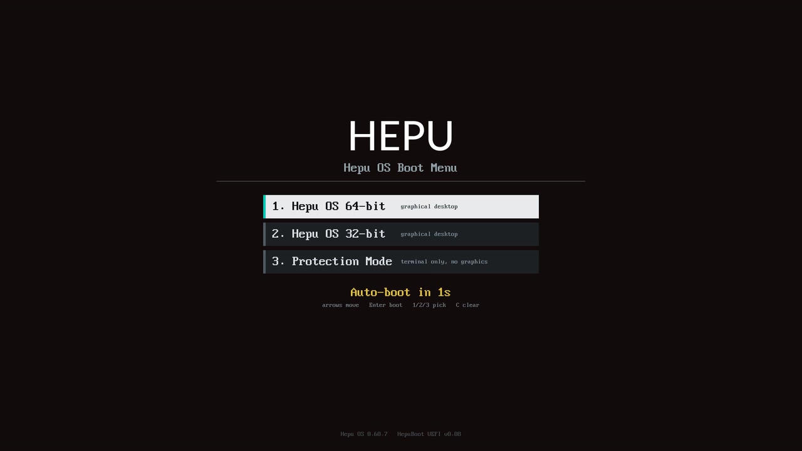
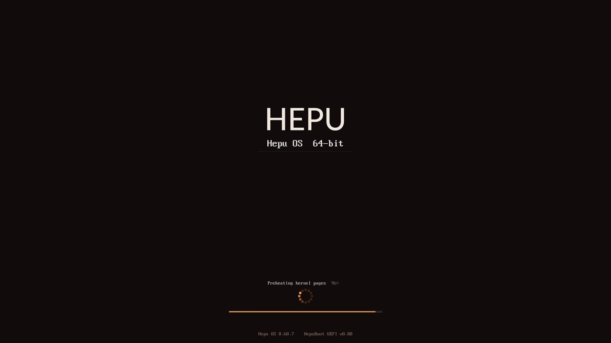
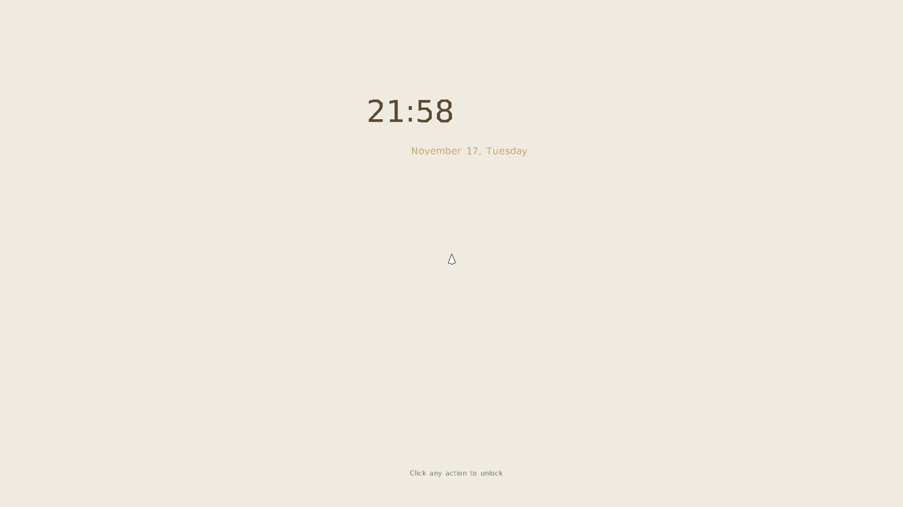
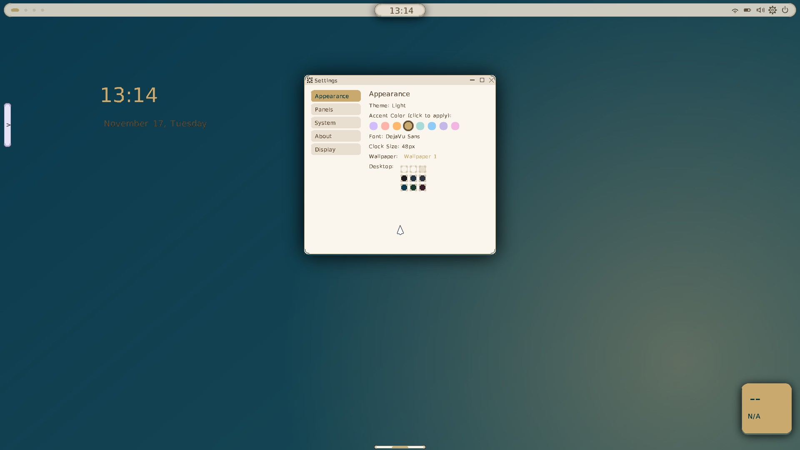
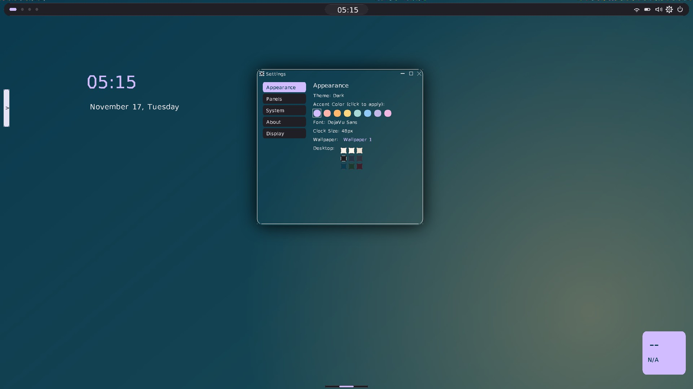
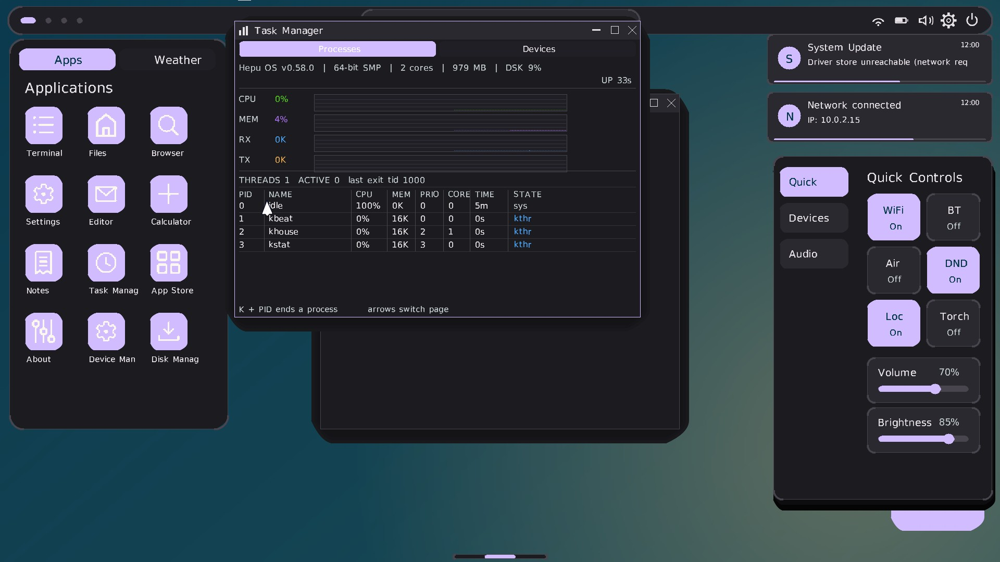

# 赫普OS / HEPU Hyper Evolve OS

> 系统归人，数据归己，自由可控，极致纯净

[](https://github.com/midongsang/hepu-os/actions/workflows/ci.yml)
[](https://github.com/midongsang/hepu-os/actions/workflows/release.yml)
[](LICENSE)
[](#当前版本)
[](#当前版本)
[](#核心特性)
[](#核心特性)
[](#核心特性)
[](https://github.com/midongsang/hepu-os/discussions)

赫普OS是一款自研 **32/64 位双架构**操作系统：32 位与 64 位共用**同一份图形桌面**
（`kernel/shared/desktop/` 注册表契约，视觉以 64 位实现为准），支持 SMP 多处理器、
双内核混合引导、ext2 文件系统和 TCP/IP 网络协议栈，用户态已具备真正的线程能力
（`clone` 共享地址空间 + 独立线程退出）。

## 启动链路

从固件到桌面是一条固定链路，四个阶段都能看到画面，中间没有黑屏空档。

<table>
<tr>
<td align="center"><br><sub>引导菜单：三个模式 + 倒计时</sub></td>
<td align="center"><br><sub>加载屏：底圈在转，状态与百分比同步推进</sub></td>
</tr>
<tr>
<td align="center"><br><sub>锁屏：大时钟 + 日期 + 解锁提示</sub></td>
<td align="center"><br><sub>登录后进入桌面</sub></td>
</tr>
</table>

### 三个模式

菜单里只有三个选项。第一次选完就成为默认（`HepuBootDefaultMode`，存在 UEFI 变量里）：

| 模式 | 进去是什么 | 什么时候用 |
|---|---|---|
| `Hepu OS 64-bit` | 64 位内核 → 图形桌面 | 默认 |
| `Hepu OS 32-bit` | 32 位内核 → **同一份**图形桌面 | 验证双架构一致 |
| `Protection Mode` | 只进文本终端，完全不碰图形 | 图形起不来时的兜底 |

连续启动失败记在 `HepuBootFailCount`：**失败 3 次自动落到保护模式**，不会在显卡问题上
无限重启。机器本身不支持 64 位时，64 位那一项变灰、选不中。

### 加载屏的圈不是装饰

底部转圈每推进一帧，都挂在一段真实工作上，不是画完再 `Stall` 的假进度：

| 状态行 | 对应真实动作 | 帧数 |
|---|---|---|
| `Loading kernel image` | 从 ESP 把内核镜像读进内存 | 前后各 8 |
| `Verifying kernel image` | CRC32 覆盖整幅镜像 | 前后各 4 |
| `Preheating kernel pages` | 逐段触碰镜像每一页，把页表建起来 | 24 |
| `Preparing to hand off` | 跳转前最后准备 | 6 |

架构选完才开始读对应那支内核 —— 选 32 位或保护模式时，不会先把 64 位镜像白读一遍。

交接时引导器在 `0x6010` 写一个 magic `0x484C4459`（ASCII `HLDY`）。内核看到它就
不再把早期文本日志画进帧缓冲、只写串口，于是加载屏能一路留到桌面第一帧，中间不闪屏。

### 锁屏与登录

开机无条件停在锁屏。设定完成前系统还没有可校验的凭据，登录页直接放行；
一旦 `/account.conf` 里有账号，就该走 SHA-256 校验 —— `auth64_verify_password` 已经实现，
把它接进登录路径是下一步。

## 支持平台与硬件

一套代码、两套内核，跑在同一类 PC 上。下表"已验证"指在 QEMU 里实测跑通并留下串口日志，
不是"驱动代码存在"。

| 维度 | 64 位（主线） | 32 位（并行内核） |
|---|---|---|
| 架构 | x86_64，长模式 | i386 兼容（multiboot） |
| 固件 | **UEFI**（唯一启动路径） | BIOS / Multiboot（GRUB 或 `-kernel` 直载） |
| 内存 | 实测 1 GB 到桌面；`.bss` 约 38.7 MB | 实测 256 MB 到桌面；`.bss` 约 92.6 MB |
| 显示 | VBE 线性帧缓冲，1920×1080，显存 ≥ 8 MB | 同左（同一份桌面代码） |
| 磁盘 | AHCI/SATA → ext2 读写；USB 存储（BOT 批量，可挂 ext2） | IDE PIO → ext2 读写（含 LBA48 读） |
| 网络 | e1000（DHCP/ARP/ICMP/TCP 端到端验证）；RTL8139 为回退 | e1000 MMIO 已接通（BAR0 页级映射 + volatile/屏障），`RCTL.BSIZE` 位段已修正（原值写在 bit17:16，实际在 bit9:8，接收缓冲只有 256 B，大于 256 B 的帧全被硬件丢弃）；**IP/UDP/DHCP 整数字节序与 IP 校验和已修正，32 位已能收到 DHCP OFFER**；RTL8139 为回退 |
| 输入 | PS/2 键盘鼠标 + USB 键鼠（UHCI 优先，EHCI/XHCI 备；两条链路可同时可用） | PS/2 |
| 中断 | APIC / IOAPIC / HPET / PIT，SMP 4 核 | PIC / PIT |
| 串口 | 16550 UART（IRQ4 已接） | 16550 UART |

**已验证的边界**：所有硬件结论均来自 QEMU（`qemu-system-x86_64` + OVMF、`qemu-system-i386`），
**真机只做过有限验证**。换机器最可能踩的三处：VBE 模式号与显存起始、PCI 多级桥下的 BAR 落点、
AHCI 厂商实现差异（ABAR 与端口复位流程）。

**明确不支持 / 未对接真硬件**：NVMe、无线网卡（无 WiFi 协议栈）、GPU 硬件加速
（只有帧缓冲直写，无 2D/3D 引擎）、音频与摄像头与 GPS（`kernel/drivers/` 下存在对应模块，
但未与真实硬件对接，属占位实现）。

> 详细的"装到机器上要什么 / 从源码编出来要什么"，见下方 [系统安装所需配置](#系统安装所需配置)。

## 当前版本

**0.61.0** — 当前版本（版本号唯一事实源：`docs/status/VERSIONING.md` frontmatter，
代码侧单一来源：`kernel/include/version.h`，32/64 位共用）

本版是**验证与整理批次**，没有新增功能，做的是把已有结论钉死、把不确定的东西标清楚。

**多架构移植可行性评估**（`docs/planning/MULTIARCH_PORT_EVALUATION.md`）：逐文件量了
桌面层的架构耦合 —— `ttf64.c`/`cursor64.c`/`l10n64.c` 的 `__asm__`、`cpuid`、`msr`、
端口 IO 全为 0，`hpdesk.c` 仅 2 处、`gfx64.c` 5 处。也就是说自研 TTF 光栅化、窗口
系统、中文化可以直接搬；成本集中在 `arch/x86_64`（92,153 行）与 `arch/x86`（68,910 行）。
按"目标平台必须有可用 UEFI 固件"这条硬约束筛出三梯队：ARM64 首选（RK3588S 明确支持
UEFI Boot、Radxa Dragon Q8B 官方标准 UEFI、飞腾派、服务器级飞腾/鲲鹏/Ampere/Graviton），
RISC-V64 次之（算能 SG2042、SpacemiT K3），LoongArch64 再次（龙芯 3A6000/3B6000M，
统一系统架构规范 V4.2 明确 UEFI + ACPI）。

**五条技术线合并，其中四条是"早已修好、本轮真机复验"**：存储 BUG-13（slave 256MB
LBA48 高 LBA 自检 `cases=0x5 fails=0x0`、宿主回读 pattern 全 match）、BUG-55（32 位
挂盘分区表/末扇区写读回/512KB 双间接块/auto-fsck 全 PASS）、BUG-54（AHCI `sectors=0x80000`
末扇区 `mismatch=0x0`）、PCI BUG-53（xHCI `MMIO 0x800000000 slots=8 ports=8`，sendkey
后 USB 报告 0→6 而 PS/2 IRQ1 恒 0x3）、BUG-56（e1000 注册且 DHCP/ARP/ICMP/TCP 齐全）、
安装器 OPEN-04（宿主机独立核对：目标盘 P1 与源盘 P1 扇区级 0 差异、ESP 四文件逐字节
一致、目标盘单盘独立启动进桌面）。另外两条是**部分修**：N-1 内存预算按方案 a 缓解
（壁纸缓存 16,384,000→12,288,000 B，稳态堆余量 8.00→11.90 MiB），P3-6 加载器拆分完成
第一阶段（新模块 `uproc_loader64.c`，并顺带修掉拆分引入的回归：返回 trampoline 漏
恢复 r13 致 `path` 被踩、panic `CR2=0x400003E7`）。

**两条口径纠正。** 其一，OBS-05"32 位桌面只画 38%"不成立：38% = 786,399 恰好只有
上 409 行上色，是启动过渡期的半幅首帧被截屏；`61c53fa` 上实测 2,073,598/2,073,600 =
100.00%（九宫格 8 格满、仅右上差 2 像素）。其二，32 位电池是**模拟放电**（
`kernel/drivers/pm.c:342-357`），掉到 5% 打印 `auto suspend pending` 后进深睡、实例约
15 秒自退，所以"静置 20 秒再截图"在 32 位上必然取不到帧 —— 32 位取样要卡在 first frame
后 ≤8 秒。

**版本号双源统一**：`kernel/include/hepu_brand.h` 里还留着一份 `V0.33.1` 的字面量
（全仓库零引用的死代码），已同步到 0.61.0，避免后续误用。

体积（默认参数重编，上限 1,048,576 B）：64 位 **969,520 B**（余量约 79 KB），
32 位 **3,761,541 B**；双架构 0 error，32 位冒烟 `serial=1 initrd=1 net=1 desk=1
fault=0 bound=1` PASS。

### 0.60.7（上一版）

0.60.7 是**内核正确性批次**，把一个长期被误判的崩溃查到了底：32 位只要多加约 1 KB
静态数据就启动失败，此前结论是"BSS 已贴边界、不能再加"。用
`qemu-system-i386 -d int,cpu_reset` 抓到异常链后才确认真实机制 ——
`e1000` 把网卡 MMIO 物理地址（`0xFEB80000`，4 GB 附近）当指针直写，而按需分页对
**任意**缺页地址都会分配一块随机物理页并映射过去，于是每写一次"网卡寄存器"
就随机篡改一块物理内存；踩到堆的 free list 就表现为 `kmalloc` 里 `#PF`，再撞上
`#DF` 变成 triple fault。同一批还修了 `e1000` 拿 `kmalloc` 堆块当 DMA 缓冲
（块被 split 后紧邻下一个 `block_header`，越界即踩坏链表），以及 `kheap`
遇 header magic 不符时不再信任坏块的 `size/next`。

### 启动链路（0.60.7 之后陆续合入）

0.60.7 之后的主线是**启动链路体验**：一条从固件到桌面、中间不留黑屏的固定路径。

| 提交 | 内容 |
|---|---|
| `5d890c4` | 菜单与内核之间加系统加载屏，底部转圈期间真的在加载（读镜像 / CRC32 / 预热页） |
| `57aba61` | 加载屏留到桌面第一帧：`0x6010` 写 `HLDY` magic，内核据此只把早期日志写串口 |
| `ebf3e05` | 开机进锁屏 —— 之前 `g_locked` 只有按 `L` 才置位，正式启动里等于没有锁屏 |
| `9d39038` | 保护模式按实际内核架构跳转，修掉"把 64 位镜像当 32 位解码"导致的重启 |
| `5f93c2d` | 32 位 `RCTL.BSIZE` 位段修正：原值写在 bit17:16，实际在 bit9:8，接收缓冲只有 256 B |
| `a787a01` | 登录三分支认证 + 中英文案接入多语言表 + OOBE 与锁屏状态优先级修正（向导原先被锁屏态提前 return 挡住） |
| `53e53cb` | 日期中文化；修掉 32 位"所有多语言文案渲染成空字符串"的假桩，改由真 l10n64.c 提供 |
| `67f1e3b` | 32 位 IP/UDP/DHCP 整数字节序与 IP 校验和修正 —— 32 位网络长期不通的真根因（发出去的帧对端不认） |
| `97db151` | 天气卡面板区域与卡片锚点统一：层区域原先把 `weather_margin_right` 当右边距，整块错位在卡片左侧 |

四个阶段都在 1920×1080 下实拍过；32 位走到的是同一张锁屏、同一份桌面代码。

### 64 位桌面（1920×1080）


### 32 位桌面（1920×1080，同一份桌面代码）



32 位与 64 位共用 `kernel/shared/desktop/` 的注册表与绘制路径，差异只在主题默认值
（上图 64 位 Light / 32 位 Dark）和系统调用入口（`int $0x80` vs `syscall`）。

*Hepu OS v0.60.7 桌面（1920×1080）：顶栏、Settings、8 色圆、网络通知*


*任务管理器 Processes 页：八列 + 七条列竖线，标签栏固定在顶部*

**线程自检实证**（串口，同一镜像）：

```
[UTHREAD] created tid=0x3E8 owner=0x0
[UTHREAD] thread exit tid=0x3E8 -> switch to tid=0x64
PASS: child ran in shared address space, both counters advanced
```

任务管理器摘要区新增 `THREADS  total/active` 与 `clone: tid P -> C` /
`thread_exit: tid A -> B` 两行，用于在桌面里直接确认线程状态。

## 核心特性

- **64位长模式内核**：约946KB（968,944字节），-O2优化，114个源码模块
- **SMP多处理器**：4核并行，per-CPU调度，负载均衡，IPI核间中断
- **双内核混合引导**：64位内核（968,944 B）+ 32位内核（3,761,541 B），启动菜单选择
- **三重引导支持**：BIOS + UEFI + CD-ROM
- **图形桌面环境**：1920×1080 真彩色，100/125/150/200% 四档 UI 缩放，TrueType 字体，窗口投影与悬停反馈
- **ext2文件系统**：完整文件/目录操作（创建/读写/删除）
- **完整网络协议栈**：ARP/IP/ICMP/UDP/TCP/DHCP/DNS/HTTP
- **用户态程序支持**：ELF64加载，ulib C库，109 个系统调用表项（号空间 0–235，详见 `docs/specs/SYSCALL_ABI.md`）
- **clone 真线程**：`CLONE_VM` 共享父地址空间，独立用户栈与独立内核栈，时钟中断轮转，共享内存双向可见
- **线程退出接口**：`SYS_HEPU_THREAD_EXIT`（235）结束当前线程而不终止整进程，在 syscall 栈上重建目标线程返回帧
- **glibc 动态链接**：PT_INTERP 引导 glibc 的 `ld-linux-x86-64.so.2`，DT_NEEDED/RELR/TLS 由用户态 ld.so 完成；`gcc -O2` 编译的 Linux PIE 程序可直接 `exec`
- **统一源码树**：13个共享模块（驱动/文件系统/图形/库/调试/安全）
- **70个Shell命令**：完整的命令行界面

## 项目结构

```
hepu-os/
├── kernel/
│   ├── kernel_main_64.c       # 64位内核主入口
│   ├── arch/x86_64/           # 64位架构相关（113个源码模块）
│   │   ├── entry_64.S         # 汇编入口
│   │   ├── process64_full.c   # 进程管理与调度
│   │   ├── smp.c              # SMP多处理器
│   │   ├── apic64.c           # APIC中断控制器
│   │   ├── ext2_64.c          # ext2文件系统
│   │   ├── gfx64.c            # 图形子系统
│   │   ├── syscall64_full.c   # POSIX系统调用
│   │   └── ...
│   ├── shared/                # 统一源码树（32/64位共享）
│   │   ├── drivers/           # 驱动框架
│   │   ├── fs/                # ext2共享算法
│   │   ├── gfx/               # 共享图形算法
│   │   ├── lib/               # 共享库函数
│   │   ├── debug/             # 调试与错误处理
│   │   └── security/          # 安全接口
│   └── fonts/                 # 字体文件
├── user/                      # 用户态程序
│   ├── ulib.h                 # 用户态C库
│   ├── hello.c                # Hello World
│   └── shell.c                # 用户态Shell
├── tools/
│   ├── hepboot/               # 自研引导器
│   │   ├── hepboot_mbr.S      # MBR引导桩
│   │   ├── x86_64/stage2_64.S # Stage2（双内核菜单）
│   │   └── uefi/              # UEFI引导器
│   ├── make_single_img64.sh   # BIOS镜像构建
│   ├── build_uefi_dual.py     # UEFI镜像构建
│   └── build_iso.py           # ISO镜像构建
├── docs/                      # 文档
└── Makefile                   # 32位内核构建
```

## 系统安装所需配置

分两件事：**装到机器上要什么**，和**从源码编出来要什么**。下表数值除标注外均为实测（在 QEMU 里跑通的最小值），不是规格书估算。

### 一、运行环境

| 项 | 64 位（主线） | 32 位（并行第二套内核） |
|---|---|---|
| CPU | x86_64，支持长模式 | i386 兼容，能跑 multiboot |
| 内存 | **1024 MB**（实测启动到桌面）<br>BSS 约 38.7 MB | **256 MB**（实测启动到桌面）<br>BSS 约 92.6 MB，见下方说明 |
| 显示 | 1920×1080，需要 VBE 线性帧缓冲 | 同左 |
| 显存 | ≥ 8 MB（1920×1080×4 = 8.3 MB，单缓冲直写） | 同左 |
| 磁盘 | 镜像 256 MB（GPT + ESP + ext2 根分区 120 MB） | 32 位内核 3.75 MB，可由引导器直接载入 |
| 固件 | **UEFI**（见下方"启动方式"） | multiboot（GRUB 或 QEMU `-kernel` 直载） |
| 输入 | PS/2 键盘 + PS/2 鼠标；USB 键鼠经 xHCI 亦可用（见下方"输入设备"） | 同左 |
| 网络 | 可选；e1000 已端到端验证（DHCP/ARP/ICMP/TCP），RTL8139 为回退路径 | 可选；RTL8139 |

装到 U 盘：≥ 512 MB 的 U 盘即可（镜像本身 256 MB）。

**关于 BSS**（这两个数是 `size -A` 实测，不是规格书估算）：

- 64 位：`.text` 620,840 / `.data` 12,272 / `.bss` 40,559,872（约 38.7 MB）
- 32 位：`.text` 860,676 / `.data` 24,876 / `.bss` 97,078,188（约 92.6 MB）

32 位的 92.6 MB 里排前几位的静态缓冲：`kf_pool` 24 MB（内核帧兜底池）、
`htpl` 8.8 MB、`back_buffer` 7.9 MB（双缓冲绘制目标）、`connections` 4 MB、
`s_hpd32_pool` 4 MB（桌面对象池）、`ht` 3.3 MB、`art` 2.7 MB、`store` 2.6 MB、
`eco` 2.5 MB、`queues` 2.1 MB、`wp_raw` 2 MB（壁纸读取缓冲）。

所以 32 位"256 MB 能跑"里，光 BSS 就占掉 92.6 MB —— 真正留给页分配器的
没有想象中多。这也是 `N-1`（2560×1600 双缓冲 + 壁纸缓存共需 32 MB）卡在
内存预算上的原因。**要往上加分辨率，先看这张表，别只看总内存。**

顺带记一条已回收的：`gfx_virtio.c` 里两个函数内 static 数组
（`fb_mem` 3.1 MB + `fb_mem_large` 8.3 MB）曾无条件下进 `.bss`，但 virtio-gpu
探测失败时 `virtio_init()` 直接 return，这两块内存从开机到关机一次都没被写过。
已改成运行时按需分配，`.bss` 因此少了 11.4 MB。

**关于输入设备**：PS/2 与 USB HID 两条链路都可用，不是"二选一"。

- PS/2：`ps2` 控制器初始化后由 IRQ1/IRQ12 投递，`g_kbd_irq_count` 递增
- USB：xHCI 起控制器后枚举 port，键鼠各占一个 slot，事件从完成环取；
  `sendkey` 实测 USB 队列 head/tail 前进而 `g_kbd_irq_count` 不变，
  证明事件确实走 USB 而非 PS/2 转发

早期 `pci_find_class_bar0` 只扫 bus 0 且只读 BAR 低 32 位，而 `qemu-xhci` 的
BAR0 是 64 位 MMIO `0x800000000`（低 dword 为 0），于是被判成"无控制器"、
USB 键鼠全部退化成 PS/2 —— 这条已修。

### 二、启动方式（这一条容易踩坑）

当前主线能构建出来的产物只有一种，且**只能 UEFI 启动**：

| 产物 | 构建命令 | 引导程序 | 启动方式 |
|---|---|---|---|
| `hepu_uefi_dual.img`（256 MB） | `python3 tools/build_uefi_dual.py` | ESP 分区里的 `/EFI/BOOT/BOOTX64.EFI` | **UEFI** |
| `build_v250/kernel.elf`（32 位） | `make` | multiboot 头 | QEMU `-kernel` 直载，或 GRUB |

`.img` 的 LBA 0 是**保护性 MBR**：分区表只有一项 `0xEE`（指向整盘），引导代码区 440 字节全为 0。它里面另加了一个 `0x83` 数据项，但那只是给**内核自己**的 IDE 扫描认分区用的（内核只认 MBR 0x83，不读 GPT），**不是 BIOS 引导代码**。所以：

- 写 U 盘用 Rufus 的 **DD 模式**，然后在 BIOS/UEFI 设置里**打开 UEFI 启动、关闭 CSM/Legacy**
- 反过来设成 Legacy/CSM 会直接"找不到可启动设备"——不是镜像坏了

> **另外三个镜像脚本的状态**（已改成"出错就说清原因"，不再是静默失败）：
> - `tools/build_combo.sh`（32 位 MBR/stage2 组合镜像）：它依赖的
>   `tools/mbr_stub.S`、`tools/bootloader.S`、`tools/bootloader.ld`、
>   `tools/mbr_legacy.bin`、`build/ext2disk.img` 已不在仓库里 —— 那套布局基于
>   `0x7C00` 基址，已被 `tools/hepboot/`（`0x8000` 基址）整体取代。现在脚本会
>   先检查源文件，缺了就打印四条指引并以 `exit 2` 退出，**不会**跑到一半产出半成品。
> - `tools/build_iso.py` / `build_hybrid_iso.py`（ISO + isohybrid）：`PROJECT`
>   常量已从硬编码的旧工作区路径改为按脚本自身位置自动推导，不会再构建另一份副本。
>   但它们仍缺一条构建规则 —— `tools/hepboot/x86_64/stage2_64.S` 有源码、没产出
>   `stage2_64.bin` 的规则，所以完整 ISO 还跑不到底。
> - `tools/build_uefi_dual.py` 会先自检 `sgdisk` / `mkfs.vfat` / `mkfs.ext2` / `mcopy`，
>   缺哪个报哪个并给出 `apt install` 命令，`exit 3`。
>
> `docs/guides/INSTALL.md` 描述的是 32 位 MBR/stage2 那条历史路径，按它操作会
> 找不到对应镜像。**装机的当前流程以本节的 `.img` 为准。**

QEMU 里验证 UEFI 启动：

```bash
qemu-system-x86_64 \
  -drive if=pflash,format=raw,readonly=on,file=OVMF_CODE_4M.fd \
  -drive if=pflash,format=raw,file=OVMF_VARS_4M.fd \
  -drive format=raw,file=/tmp/hepu_uefi_dual.img \
  -m 1024 -smp 2 -vga std -serial file:/tmp/hepu_serial.log
```

### 三、构建环境（Linux 主机）

不需要交叉编译工具链：**用本机 `gcc` 加 `-m32` / `-m64`**。

| 依赖 | 用途 | 缺了会怎样 |
|---|---|---|
| `gcc`（需 multilib，能编 `-m32`） | 编译两个架构的内核与用户程序 | 编不过 |
| `binutils`（`ld`） | 链接（32 位用 `-m elf_i386`） | 编不过 |
| `python3` | 构建 ESP / GPT / ext2 与 initrd | 出不了镜像 |
| `sgdisk`（gdisk 包） | GPT 分区表 | **静默产出空 ESP**（不报错，起不来） |
| `mtools`（`mcopy`） | 往 ESP 的 FAT32 里放文件 | 同上 |
| `debugfs`（e2fsprogs） | 往 ext2 根分区写文件 | 根分区是空的 |
| `qemu-system-x86_64` | 64 位 UEFI 测试 | 测不了 |
| `qemu-system-i386` | 32 位 multiboot 测试 | 测不了 |
| OVMF（`OVMF_CODE_4M.fd` / `OVMF_VARS_4M.fd`） | UEFI 固件 | 起不来 |

一条命令检查前四项在不在：

```bash
for c in gcc ld python3 sgdisk mcopy debugfs; do
  command -v $c >/dev/null && echo "ok   $c" || echo "MISS $c"
done
```

## 快速开始

### 编译64位内核（主线）
```bash
make -C kernel/arch/x86_64 -j4
# 输出: build_x86_64/hepu-kernel64.bin（当前 957,360 B，上限 1 MB）
```

### 编译用户态程序
```bash
make -C user
# 输出: user/build/*.elf（hello/sec_test/clone_test/ps/shell 等）
```

### 编译32位内核
```bash
make
# 输出: build_v250/kernel.elf（当前 3,927,888 B）+ hepu-kernel.bin
```

### 构建 UEFI 镜像（推荐）
```bash
python3 tools/build_uefi_dual.py
# 输出: /tmp/hepu_uefi_dual.img (256MB, GPT + ESP + ext2 根分区)
# 依赖: sgdisk / mtools(mcopy) / debugfs —— 缺 sgdisk 会静默产出空 ESP
```

### QEMU 测试（UEFI + 双核）
```bash
qemu-system-x86_64 \
  -drive if=pflash,format=raw,readonly=on,file=OVMF_CODE_4M.fd \
  -drive if=pflash,format=raw,file=OVMF_VARS_4M.fd \
  -drive format=raw,file=/tmp/hepu_uefi_dual.img \
  -m 1024 -smp 2 -vga std -serial file:/tmp/hepu_serial.log
```
启动到桌面约 50 秒；串口日志混有二进制输出，`grep` 需带 `-a`。

### 真机启动
- 用 Rufus **DD 模式**把 `.img` 写入 U 盘（或 balenaEtcher）
- 固件设置：**打开 UEFI 启动、关闭 CSM/Legacy**
- 原因见上方「启动方式」：镜像的 LBA 0 是保护性 MBR，没有 BIOS 引导代码，
  设成 Legacy 只会"找不到可启动设备"

## 系统调用（号空间 0–235，`SYS_MAX = 236`）

系统调用 ABI 由 `tools/gen_syscall_doc.py` 从源码 `kernel/arch/x86_64/syscall64_full.c` 自动生成，完整列表见 [`docs/specs/SYSCALL_ABI.md`](docs/specs/SYSCALL_ABI.md)。

核心调用示例：

| 调用号 | 名称 | 功能 |
|--------|------|------|
| 5 | exit | 进程退出 |
| 7 | getpid | 获取进程 ID |
| 8 | open | 打开文件 |
| 9 | read | 读取文件 |
| 10 | write | 写入文件 |
| 11 | close | 关闭文件 |
| 14 | lseek | 文件定位 |
| 15 | sleep | 睡眠（毫秒） |
| 40 | clone | 创建线程（共享地址空间） |
| 41 | waitpid | 等待子进程 |
| 42 | execve | 执行程序 |
| 43 | fork | 创建子进程 |
| 64 | brk | 调整堆顶 |
| 235 | hepu_thread_exit | 线程退出（不终止整进程） |

> 注：系统同时维护 Linux x86_64 调用号翻译表，可直接运行主机 `gcc -static` 编译的原生 Linux ELF。

## SMP多处理器

- **4核支持**：BSP + 3个AP全部在线
- **per-CPU调度**：每个CPU独立Local APIC定时器（1000Hz）
- **负载均衡**：进程轮询分配，工作窃取机制
- **IPI核间中断**：支持单目标/广播/其他CPU
- **自旋锁**：保护共享数据结构

## 双内核混合引导

当前主线产物（`tools/build_uefi_dual.py`）的实际布局：

```
LBA 0            保护性 MBR（仅 0xEE 数据项 + 一个 0x83 给内核认分区，无引导代码）
ESP (FAT32)      LBA 2048 起，262144 扇区（128 MB）
                 /EFI/BOOT/BOOTX64.EFI    UEFI 引导器（hepboot）
                 /KERNEL64.BIN            64 位内核
                 /KERNEL32.BIN            32 位内核（存在 build_v250/hepu-kernel.bin 时才写入）
                 /HEPBOOT.CFG             kernel_arch=64 | 32 切换
ext2 根分区      LBA 264192 起，245760 扇区（120 MB），/bin 下是各用户程序
总大小           256 MB
```

引导器按 `HEPBOOT.CFG` 的 `kernel_arch` 选内核；默认 64 位。

> 早期版本用过另一种布局（MBR stage2 在 LBA 34-65、内核在 LBA 2000/3400、ext2 在 LBA 13000）。那段描述对应的是 BIOS 路径，与当前 UEFI 产物不是同一套，已按实际产物更正。

## 开发状态

### 已完成
- ✅ 32/64 位双架构内核（尺寸随构建变化，最新值见 [当前版本](#当前版本)）
- ✅ 启动链路（三模式菜单 → 加载屏 → 锁屏 → 登录 → 桌面，四阶段实拍验证）
- ✅ SMP多处理器（4核，负载均衡，IPI）
- ✅ 双内核混合引导（64位+32位）
- ✅ 三重引导（BIOS+UEFI+CD-ROM）
- ✅ 图形桌面（1920×1080，四档 UI 缩放，TrueType 字体）
- ✅ ext2文件系统（完整操作）
- ✅ 网络协议栈（TCP/IP+HTTP）
- ✅ 用户态程序（ELF64+ulib库，Linux静态ELF兼容）
- ✅ 109 个系统调用表项（0–235）
- ✅ 统一源码树（13个共享模块）
- ✅ clone 真线程（共享地址空间 + 独立栈 + 时钟轮转）
- ✅ 线程退出接口 SYS_HEPU_THREAD_EXIT=235
- ✅ 70个Shell命令

### 版本历史

详细迭代记录见 [`docs/status/VERSIONING.md`](docs/status/VERSIONING.md)（版本号唯一事实源）。历史归档见 [`docs/history/`](docs/history/) 目录。

## 开源协议

核心代码采用 **GPLv3** 许可证。

## 命名释义

- **赫**：赫然革新、突破壁垒
- **普**：普惠自由、全设备通用
- **HEPU**：Hyper Evolve Pure Union
