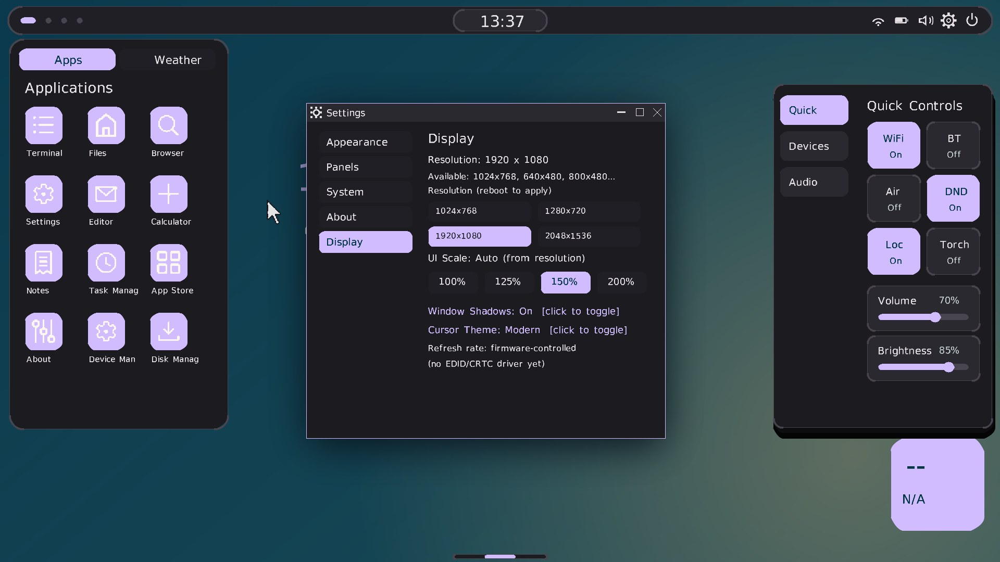

# 赫普OS / HEPU Hyper Evolve OS

> 系统归人，数据归己，自由可控，极致纯净

[](https://github.com/midongsang/hepu-os/actions/workflows/ci.yml)
[](https://github.com/midongsang/hepu-os/actions/workflows/release.yml)
[](LICENSE)
[](#当前版本)
[](#当前版本)
[](#核心特性)
[](#核心特性)
[](#核心特性)
[](https://github.com/midongsang/hepu-os/discussions)

赫普OS是一款自研64位操作系统，支持SMP多处理器、双内核混合引导、完整图形桌面、ext2文件系统和TCP/IP网络协议栈，
用户态已具备真正的线程能力（`clone` 共享地址空间 + 独立线程退出）。

## 当前版本

**0.59.0** — 当前版本（版本号唯一事实源：`docs/status/VERSIONING.md` frontmatter）

本版是桌面层的收口：任务管理器拆成 `Processes` / `Devices` 两页（进程表八列带竖线、
PRIO/CORE/TIME 有真实数据），四条 CPU/MEM/RX/TX 视图改成连续面积图并补满宽度，
补齐全系统通用滚动条；窗口投影从"三层不透明色带"换成真卷积高斯 mask（按窗口短边
自适应圆角/半径/偏移，Display 页可关闭）；新增内置第二套光标 Modern（48px 线稿双色
压缩，17 个形态共 34.7KB）并随 UI 缩放档放大，Display 页可切换。

期间查清了一个把前两轮阴影工作全部作废的问题：`hpdesk.c` 把 `gfx64.c` 的宏当全局
变量 `extern`，链接一直失败，而验证命令 `grep ' error'` 匹配不到 `undefined reference`，
于是三次"改完看着还是假"其实都在跑旧镜像 —— 详见 `docs/status/PROGRESS_0_59.md`。



*Hepu OS v0.59.0 桌面：Display 页的投影/光标开关、Modern 光标、Quick Controls*


*任务管理器 Processes 页：八列 + 七条列竖线，标签栏固定在顶部*

**线程自检实证**（串口，同一镜像）：

```
[UTHREAD] created tid=0x3E8 owner=0x0
[UTHREAD] thread exit tid=0x3E8 -> switch to tid=0x64
PASS: child ran in shared address space, both counters advanced
```

任务管理器摘要区新增 `THREADS  total/active` 与 `clone: tid P -> C` /
`thread_exit: tid A -> B` 两行，用于在桌面里直接确认线程状态。

## 核心特性

- **64位长模式内核**：约852KB（872,656字节），-O2优化，114个源码模块
- **SMP多处理器**：4核并行，per-CPU调度，负载均衡，IPI核间中断
- **双内核混合引导**：64位内核（约807KB）+ 32位内核（约3.85MB），启动菜单选择
- **三重引导支持**：BIOS + UEFI + CD-ROM
- **图形桌面环境**：1920×1080 真彩色，100/125/150/200% 四档 UI 缩放，TrueType 字体，窗口投影与悬停反馈
- **ext2文件系统**：完整文件/目录操作（创建/读写/删除）
- **完整网络协议栈**：ARP/IP/ICMP/UDP/TCP/DHCP/DNS/HTTP
- **用户态程序支持**：ELF64加载，ulib C库，109 个系统调用表项（号空间 0–235，详见 `docs/specs/SYSCALL_ABI.md`）
- **clone 真线程**：`CLONE_VM` 共享父地址空间，独立用户栈与独立内核栈，时钟中断轮转，共享内存双向可见
- **线程退出接口**：`SYS_HEPU_THREAD_EXIT`（235）结束当前线程而不终止整进程，在 syscall 栈上重建目标线程返回帧
- **glibc 动态链接**：PT_INTERP 引导 glibc 的 `ld-linux-x86-64.so.2`，DT_NEEDED/RELR/TLS 由用户态 ld.so 完成；`gcc -O2` 编译的 Linux PIE 程序可直接 `exec`
- **统一源码树**：13个共享模块（驱动/文件系统/图形/库/调试/安全）
- **70个Shell命令**：完整的命令行界面

## 项目结构

```
hepu-os/
├── kernel/
│   ├── kernel_main_64.c       # 64位内核主入口
│   ├── arch/x86_64/           # 64位架构相关（113个源码模块）
│   │   ├── entry_64.S         # 汇编入口
│   │   ├── process64_full.c   # 进程管理与调度
│   │   ├── smp.c              # SMP多处理器
│   │   ├── apic64.c           # APIC中断控制器
│   │   ├── ext2_64.c          # ext2文件系统
│   │   ├── gfx64.c            # 图形子系统
│   │   ├── syscall64_full.c   # POSIX系统调用
│   │   └── ...
│   ├── shared/                # 统一源码树（32/64位共享）
│   │   ├── drivers/           # 驱动框架
│   │   ├── fs/                # ext2共享算法
│   │   ├── gfx/               # 共享图形算法
│   │   ├── lib/               # 共享库函数
│   │   ├── debug/             # 调试与错误处理
│   │   └── security/          # 安全接口
│   └── fonts/                 # 字体文件
├── user/                      # 用户态程序
│   ├── ulib.h                 # 用户态C库
│   ├── hello.c                # Hello World
│   └── shell.c                # 用户态Shell
├── tools/
│   ├── hepboot/               # 自研引导器
│   │   ├── hepboot_mbr.S      # MBR引导桩
│   │   ├── x86_64/stage2_64.S # Stage2（双内核菜单）
│   │   └── uefi/              # UEFI引导器
│   ├── make_single_img64.sh   # BIOS镜像构建
│   ├── build_uefi_dual.py     # UEFI镜像构建
│   └── build_iso.py           # ISO镜像构建
├── docs/                      # 文档
└── Makefile                   # 32位内核构建
```

## 快速开始

### 编译64位内核（主线）
```bash
make -C kernel/arch/x86_64 -j4
# 输出: build_x86_64/hepu-kernel64.bin (约807KB)
```

### 编译用户态程序
```bash
make -C user
# 输出: user/build/*.elf（hello/sec_test/clone_test/ps/shell 等）
```

### 编译32位内核
```bash
make
# 输出: build_v250/hepu-kernel.bin (4.1MB)
```

### 构建 UEFI 镜像（推荐）
```bash
python3 tools/build_uefi_dual.py
# 输出: /tmp/hepu_uefi_dual.img (256MB, GPT + ESP + ext2 根分区)
# 依赖: sgdisk / mtools(mcopy) / debugfs —— 缺 sgdisk 会静默产出空 ESP
```

### QEMU 测试（UEFI + 双核）
```bash
qemu-system-x86_64 \
  -drive if=pflash,format=raw,readonly=on,file=OVMF_CODE_4M.fd \
  -drive if=pflash,format=raw,file=OVMF_VARS_4M.fd \
  -drive format=raw,file=/tmp/hepu_uefi_dual.img \
  -m 1024 -smp 2 -vga std -serial file:/tmp/hepu_serial.log
```
启动到桌面约 50 秒；串口日志混有二进制输出，`grep` 需带 `-a`。

### 真机启动
- 使用Rufus **DD模式**写入.img到U盘
- 或使用balenaEtcher
- BIOS设置：Legacy模式，USB第一启动

## 系统调用（109 个表项，号空间 0–235）

系统调用 ABI 由 `tools/gen_syscall_doc.py` 从源码 `kernel/arch/x86_64/syscall64_full.c` 自动生成，完整列表见 [`docs/specs/SYSCALL_ABI.md`](docs/specs/SYSCALL_ABI.md)。

核心调用示例：

| 调用号 | 名称 | 功能 |
|--------|------|------|
| 5 | exit | 进程退出 |
| 7 | getpid | 获取进程 ID |
| 8 | open | 打开文件 |
| 9 | read | 读取文件 |
| 10 | write | 写入文件 |
| 11 | close | 关闭文件 |
| 14 | lseek | 文件定位 |
| 15 | sleep | 睡眠（毫秒） |
| 40 | clone | 创建线程（共享地址空间） |
| 41 | waitpid | 等待子进程 |
| 42 | execve | 执行程序 |
| 43 | fork | 创建子进程 |
| 64 | brk | 调整堆顶 |
| 235 | hepu_thread_exit | 线程退出（不终止整进程） |

> 注：系统同时维护 Linux x86_64 调用号翻译表，可直接运行主机 `gcc -static` 编译的原生 Linux ELF。

## SMP多处理器

- **4核支持**：BSP + 3个AP全部在线
- **per-CPU调度**：每个CPU独立Local APIC定时器（1000Hz）
- **负载均衡**：进程轮询分配，工作窃取机制
- **IPI核间中断**：支持单目标/广播/其他CPU
- **自旋锁**：保护共享数据结构

## 双内核混合引导

镜像布局：
```
MBR (LBA0) → Stage2 (LBA34-65, 32KB)
  → 64位内核 (LBA2000+, 最多640KB)
  → 32位内核 (LBA3400+, 最多4.1MB)
  → ext2根分区 (LBA13000+, 224MB)
```

Stage2启动菜单：5秒倒计时，默认64位，可选择32位。

## 开发状态

### 已完成
- ✅ 64位内核基础（113个源码模块，约807KB）
- ✅ SMP多处理器（4核，负载均衡，IPI）
- ✅ 双内核混合引导（64位+32位）
- ✅ 三重引导（BIOS+UEFI+CD-ROM）
- ✅ 图形桌面（1920×1080，四档 UI 缩放，TrueType 字体）
- ✅ ext2文件系统（完整操作）
- ✅ 网络协议栈（TCP/IP+HTTP）
- ✅ 用户态程序（ELF64+ulib库，Linux静态ELF兼容）
- ✅ 109 个系统调用表项（0–235）
- ✅ 统一源码树（13个共享模块）
- ✅ clone 真线程（共享地址空间 + 独立栈 + 时钟轮转）
- ✅ 线程退出接口 SYS_HEPU_THREAD_EXIT=235
- ✅ 70个Shell命令

### 版本历史

详细迭代记录见 [`docs/status/VERSIONING.md`](docs/status/VERSIONING.md)（版本号唯一事实源）。历史归档见 [`docs/history/`](docs/history/) 目录。

## 开源协议

核心代码采用 **GPLv3** 许可证。

## 命名释义

- **赫**：赫然革新、突破壁垒
- **普**：普惠自由、全设备通用
- **HEPU**：Hyper Evolve Pure Union
