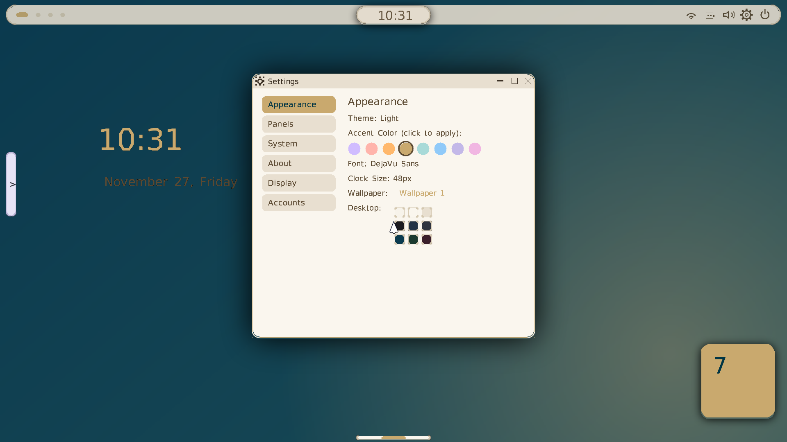
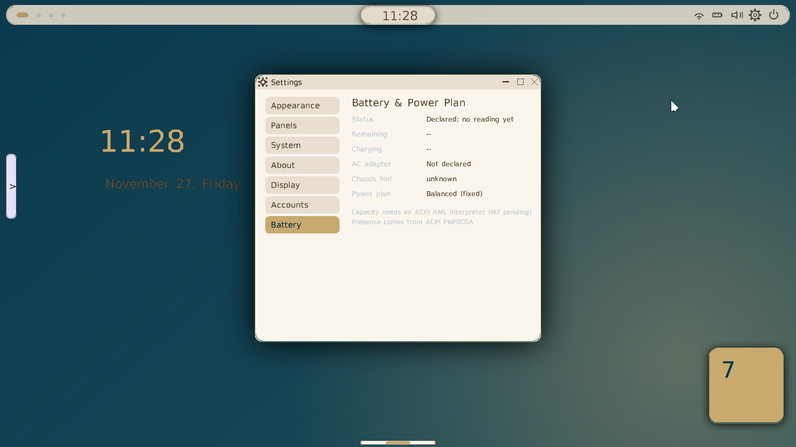

# 电池状态取证（2026-11-27，M0 + M1 + M1.5 图标 + M1.6 面板）

## 结论

赫普之前的“电池 100%”不是检测结果，是 `hs_status_init` 里写死的
`battery_percent = 100`。本轮先做两件事，**不涉及真实电量读取**：

1. **M0**：移除假 100%；新增 `HS_BATTERY_ABSENT / DECLARED / VALID / UNKNOWN`
   状态；顶栏只在非 `ABSENT` 时绘制电池；`DECLARED / UNKNOWN` 只画轮廓和两道短线，
   不画百分比；32 位 `device_support.c` 不再写死“no battery(台式机)”。
2. **M1**：新增 `kernel/arch/x86_64/firmware_info.c/.h`：
   - SMBIOS：扫描 `_SM_` / `_SM3_` entry point，读 Type 3 Chassis Type；
   - ACPI：从 RSDP → RSDT/XSDT 找 `FACP`，取 `DSDT`，并枚举 `SSDT`；
   - 在 DSDT/SSDT 原始字节里查 `PNP0C0A`（电池）和 `ACPI0003`（交流适配器），
     同时识别 ASCII 字符串与 AML 压缩 EISA ID（`0x41D00C0A` / `0x04700003`）。

**边界**：M1 只能到 `DECLARED`，因为还没有 AML 执行器，不能读 `_STA`、`_BIX`、
`_BST`；本轮没有 `VALID`、没有真实百分比、没有真实硬件结论。M2 未开始。

## 判据

- 电池是否存在：只认 ACPI `PNP0C0A` 声明；SMBIOS Type 3 只写 `form_factor`，
  不参与电池开关。
- `ABSENT`：不画电池、不参与低电量策略；
- `DECLARED / UNKNOWN`：画电池轮廓 + `--`，不回退 100%；
- `VALID`：只有读到可信电量才允许（M2，未实现）。

## QEMU 证据

### 1. 默认 QEMU（无电池设备）

命令：`bash tools/regress/battery_state_probe.sh .../default`

串口：

```text
[BAT] smbios=0x0 chassis=0x0 form=unknown
[BAT] acpi=0x1 fadt=0x1 dsdt=0x1 ssdt=0x0 battery=absent
[BAT] state=absent form_factor=unknown acpi_battery=absent reason=no-acpi-battery
```

桌面顶栏右侧：


可见 WiFi / 音量 / 设置 / 电源，没有电池图标，也没有 `100%`。这是本轮要修的
用户可见问题。

### 2. 注入合成 SSDT（声明 PNP0C0A）

夹具：`fixture/battery-declared.ssdt`，由 `tools/regress/make_battery_ssdt.py`
生成，只包含一个最小 `Device(BAT0)`，声明 `_HID = "PNP0C0A"` 和 `_STA = 0x0F`。
它不是产品固件，只用于验证 M1 的“声明存在 → DECLARED”分支。

命令：

```bash
bash tools/regress/battery_state_probe.sh .../declared .../fixture/battery-declared.ssdt
```

串口：

```text
[BAT] smbios=0x0 chassis=0x0 form=unknown
[BAT] acpi=0x1 fadt=0x1 dsdt=0x1 ssdt=0x2 battery=declared
[BAT] state=declared form_factor=unknown acpi_battery=declared reason=acpi-declared
```

桌面顶栏右侧：



可见电池轮廓 + 两道短线（`--`），没有 100%。这证明 UI 已按状态条件渲染，
而不是无条件画满电。

### 3. 宿主核对

`python3 host_check.py` 的 `host-check.txt`：

```text
default: state=absent reason=no-acpi-battery
declared: state=declared reason=acpi-declared
top-right diff pixels=312 bbox=(275, 31, 343, 47)

default_state_absent         PASS  absent
default_reason_no_battery    PASS  no-acpi-battery
declared_state_declared      PASS  declared
default_size_1920x1080       PASS  (1920, 1080)
declared_size_1920x1080      PASS  (1920, 1080)
topright_changed             PASS  pixels=312 bbox=(275, 31, 343, 47)

RESULT: PASS
```

差异只落在顶栏右侧，不是整屏偶然变化。

### 4. 图标层（M1.5，2026-11-27 追加）

用户 2026-11-11 给的图标批次里，电池有两种形态，都留在仓库里：

| 素材 | 形态 | 结论 |
|---|---|---|
| `assets/icons-v2/128_battery_std.png` | 128×128 实心竖版 | 24px 下是一块黑砖，不可用（当时已否） |
| `assets/icons-status64/p64_battery64.png` | 线性横版（机身 + 正极） | 可用；但像素里烧死了“约 69% 电量” |

直接贴第二张就是让图标自己谎报 69%，和 M0 的原则冲突。所以
`tools/gen_battery_glyph.py` 按素材实测几何（机身 40×20@64、描边 4、正极 3×8）
重建**轮廓层**，输出 `kernel/arch/x86_64/hs_battery_glyph.h`；顶栏改用它与
wifi/音量/齿轮/电源同一条 `hs_icon_bmp64()` 覆盖采样管线。差异只有两处：
去掉烧死的填充；正极由留 2px 间隙改为贴合机身（否则 24px 下正极脱开成孤点）。

电量层由状态驱动，纯函数放在 `hpdesk.h`：`hs_battery_ui_mode()`
（0 不画 / 1 轮廓+两道短线 / 2 轮廓+填充）与 `hs_battery_fill_px()`。
`tools/host-tests/battery_ui_test.c` 覆盖四种状态与填充边界——因为 QEMU 里
`VALID` 不可达，没有这条单测，填充分支就是没人跑过的死代码。

`python3 icon_check.py` 结果（`icon-topbar/check.txt`）：

```text
default_absent             PASS  state=absent reason=no-acpi-battery
declared_declared          PASS  state=declared reason=acpi-declared
size_1920x1080             PASS  (1920, 1080) / (1920, 1080)
wide_runs_default_2        PASS  [(1720, 1742), (1806, 1836)]
wide_runs_declared_3       PASS  [(1675, 1697), (1718, 1742), (1806, 1836)]
battery_width_20_30        PASS  x=[(1718, 1742)]
battery_height_le_16       PASS  h=12
right_icons_unmoved        PASS  x 1750..1885 逐像素相同

RESULT: PASS
```

声明态比默认态多一个 25×12px 的独立墨段（电池），右侧三个图标逐像素未移动——
说明是“插入了一个图标”，不是把邻居改胖或整排重排。


### 5. 面板与设置页（M1.6，2026-11-27 追加）

用户要求：点顶栏电池图标要展开看剩余电量和状态，面板右下角放“电池和电源计划”
入口，点它直接进 Settings 的电池页。三件事都在同一轮点击轨迹里验：

1. 点电池图标 → 面板展开。`VALID` 才有数字，`DECLARED` 显示 `--` +
   “Declared by firmware; no reading yet”；右下角是 accent 实心入口按钮。
2. 点入口 → Settings 直接落在第 7 项 `Battery`（不是先开首页再手点）。
3. 导航里第 4 项 About 仍能点（加页没挤掉旧索引），第 7 项 Battery 自己也能进；
   两条入口得到的页面内容**逐像素相同**。

面板与命中是同一套几何（`hs_battery_icon_rect()` 算槽位，`hs_battery_panel_geom()`
算面板和入口矩形），绘制用它们、点击也用它们，不存在“画得大点得小”。面板画在
窗口、控制中心、通知之后——它是顶栏浮层，必须压在最上面。

命令：

```bash
bash tools/regress/battery_panel_probe.sh .../panel .../fixture/battery-declared.ssdt
bash tools/regress/battery_panel_probe.sh .../panel/absent
```

同一轮串口（声明态）：

```text
[BAT] state=declared form_factor=unknown acpi_battery=declared reason=acpi-declared
[DESK] battery panel open
[DESK] battery panel -> settings page=battery
[SETTINGS] nav page=0x3
[SETTINGS] nav page=0x6
```

无电池这一次：`[BAT] state=absent`，点击电池本该在的位置**不产生面板**
（串口没有 `battery panel open`）——因为那里根本没有电池图标，指针只有 4 个槽。




`python3 panel_check.py`（`panel/check.txt`）：

```text
A1 声明态 wifi 槽有墨迹          PASS  ink=107
A2 声明态 电池槽有墨迹           PASS  ink=191
B1 无电池 wifi 左移后原槽位空白   PASS  ink=0
B4 无电池点击不产生面板          PASS
C1 面板矩形内像素发生变化         PASS  changed=70794/73125
C2 右下角入口是 accent 实心按钮   PASS  accent=0.73
D1 导航第 7 项 Battery 高亮      PASS  accent=0.84
E1 About 高亮(旧索引未被挤掉)     PASS  accent=0.85
F1 两个入口的电池页内容逐像素相同  PASS  diff=0

RESULT: PASS (19 checks, 0 failed)
```

电源计划一栏写的是“均衡（固定）”。64 位内核没有调度策略引擎（`kopt` 只在 32 位、
且只是记账，没有真正的频率控制），所以这里不做一个点了没反应的假开关——
宁可写清楚“固定”，也不给一个假控件。

## 构建

`bash tools/regress/build_all.sh` 通过：gnu-efi、UEFI 引导器、64 位内核、
32 位内核、双内核镜像全部成功；产物 `kernel64.bin` 1,032,080 B、
`kernel32.bin` 3,873,229 B（M1.5 的 +512 B 是电池轮廓掩码 64×8，M1.6 再加上面板/电池页代码）。

- `tools/host-tests/run_host_tests.sh`：`通过 9 / 失败 0`（新增 `battery_ui`）。
- `tools/regress/smoke32.sh`：`serial=1 initrd=1 net=1 desk=1 fault=0`、
  `ktest_result=PASS`、`p3-security: passed=2 failed=0 skipped=0`。
- 32 位只验证到“构建 + 冒烟不回归”，没有单独截 32 位桌面截图。

## 未闭环 / 不要误读

1. **M1 不是 AML 执行器**：`DECLARED` 只说明固件表里有电池设备声明，不代表
   `_STA` 为 present/enabled，也不代表现在有电。要读真实电量必须做 M2。
2. **SMBIOS 在本次 QEMU/OVMF 里没有 legacy entry**：串口 `smbios=0x0`、
   `form_factor=unknown`；加 `-smbios type=3,manufacturer=HEPU` 复测仍为 0。
   这不是电池判据失败；电池仍由 ACPI 判为 `ABSENT`。真笔记本/真台式机的
   SMBIOS Type 3 还没取到，不能把 `form_factor` 写成已验证。
3. **QEMU 合成表不代表真机**：`-acpitable` 只验证解析与 UI 链路；真机 DSDT
   可能把 `_HID` 放在更复杂的 `Scope`/`Method` 里，M2 的 AML 路径仍需单独实现。
4. **32 位只做了去硬编码 + 构建**：没有 32 位桌面截图回归；本轮不宣称 32 位
   电池 UI 已完整对齐。
5. **没有真机证据**：没有真笔记本、真台式机或 UPS 的取证；本目录只能支撑
   “QEMU 默认不再显示假电池”和“声明探测链路可用”，不能写成“真机已修复”。
6. **`VALID` 的填充只有单测覆盖**：`hs_battery_fill_px()` / `hs_battery_ui_mode()`
   在主机端跑过全部分支，但 QEMU 里造不出 `VALID`——要看到真实百分比填充仍是 M2。
7. **面板里的数字仍受 M2 限制**：`VALID` 之外一律 `--`，面板没有把 `DECLARED`
   当 0% 或 100%。点开能看到的“状态”是 ACPI 探测结果，不是电量。
8. **点击链路是 QEMU 夹具**：取证用 `usb-tablet` + QMP 绝对坐标（相对指针在
   QEMU 里推不准）。真机鼠标走的是同一条 `hpdesk_mouse_down()`，但没有真机
   点击取证；`usb-tablet` 之外的绝对指针设备也没测。

## 复现文件

| 文件 | 作用 |
|---|---|
| `tools/regress/battery_state_probe.sh` | 启动 64 位桌面、抓 `[BAT]` 串口与截图；可选 `-acpitable` |
| `tools/regress/make_battery_ssdt.py` | 生成含 `PNP0C0A` 的最小合成 SSDT |
| `fixture/battery-declared.ssdt` | 本次实际注入的 64 字节表 |
| `default/` | 默认 QEMU 串口、截图、`bat-lines.txt` |
| `declared/` | 合成 SSDT 串口、截图、`bat-lines.txt` |
| `host_check.py` / `host-check.txt` | 宿主侧可复算核对 |
| `tools/gen_battery_glyph.py` | 从用户素材重建电池轮廓层，生成 `hs_battery_glyph.h`（`--check` 可校验一致性） |
| `tools/host-tests/battery_ui_test.c` | 状态→图标映射与填充宽度的主机端单测 |
| `icon-topbar/` | 图标层取证：两次运行的截图、3× 顶栏、`icon_check.py` / `check.txt` |
| `tools/regress/battery_panel_probe.sh` | 点电池→面板→入口→电池页 的整条点击轨迹；挂 `usb-tablet` 走 QMP 绝对点击 |
| `tools/regress/qmp_click.py` | QMP 绝对坐标点击（0..32767 换算），供上面的脚本调用 |
| `panel/` | 声明态取证：`01-desktop` / `02-panel` / `03-settings` / `04-about` / `05-battery-nav`、`ser.log`、`panel_check.py` / `check.txt` |
| `panel/absent/` | 默认夹具（无电池）跑同一套点击：证明点不出面板 |
