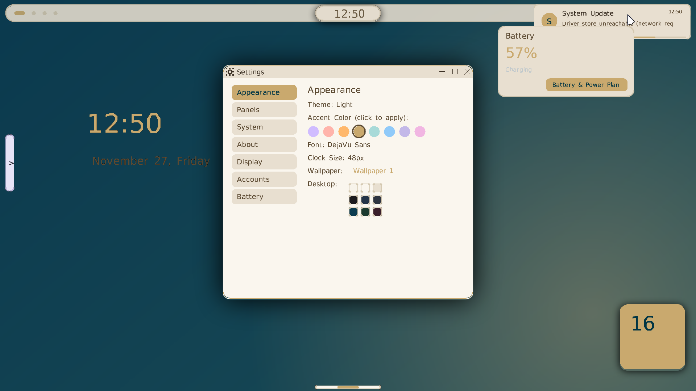
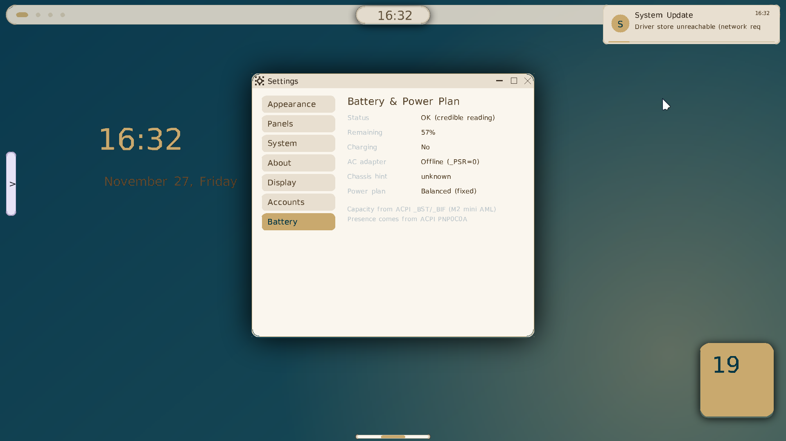

# 电池状态取证（2026-11-27，M0 + M1 + M1.5 图标 + M1.6 面板 + M2 最小版 + EC 只读 + _REG/_PSR）

## 结论

赫普之前的“电池 100%”不是检测结果，是 `hs_status_init` 里写死的
`battery_percent = 100`。本轮分五步推进：前两步只搭状态骨架，后三步才读真实电量：

1. **M0**：移除假 100%；新增 `HS_BATTERY_ABSENT / DECLARED / VALID / UNKNOWN`
   状态；顶栏只在非 `ABSENT` 时绘制电池；`DECLARED / UNKNOWN` 只画轮廓和两道短线，
   不画百分比；32 位 `device_support.c` 不再写死“no battery(台式机)”。
2. **M1**：新增 `kernel/arch/x86_64/firmware_info.c/.h`：
   - SMBIOS：扫描 `_SM_` / `_SM3_` entry point，读 Type 3 Chassis Type；
   - ACPI：从 RSDP → RSDT/XSDT 找 `FACP`，取 `DSDT`，并枚举 `SSDT`；
   - 在 DSDT/SSDT 原始字节里查 `PNP0C0A`（电池）和 `ACPI0003`（交流适配器），
     同时识别 ASCII 字符串与 AML 压缩 EISA ID（`0x41D00C0A` / `0x04700003`）。
3. **M2 最小版**：新增 `aml64.c/.h`（极简 AML 解释器）与 `acpi_battery.c/.h`，
   在 QEMU 合成表上真实执行 `_STA` / `_BIF` / `_BIX` / `_BST`；读到可信读数才进
   `VALID`，顶栏、面板、Settings 电池页同步显示 `57%` / `Charging: Yes`。
   读不出或不可信仍保持 `DECLARED` 的 `--`，绝不回退 100%。
4. **M2-full 第一步（EC 只读 + `_REG`）**：新增 `ec64.c/.h` 与 AML
   `EmbeddedControl`（space 3）字段读；只有命名空间里存在 `PNP0C09` 才启用 EC。
   AML 新增带整数参数的方法求值，EC 初始化时执行 `_REG(EmbeddedControl,1)`，
   每个电池采样重放一次，保证 `_BST` 能看到 `_REG` 置的 EC 标志。EC 事务只支持
   `RD_EC 0x80`，超时/状态异常一律 fail-closed。QEMU 没有 ACPI EC 设备，
   正路径由主机端模拟状态机覆盖；真实 EC 机器尚未验证。
5. **`_PSR` 交流状态**：新增 `acpi_ac_poll`，读 `ACPI0003._PSR`；Settings
   电池页的交流适配器行从“未声明”升级为 `Online (_PSR=1)` / `Offline (_PSR=0)`，
   读不到 `_PSR` 时才退回“已声明 / 未声明”。AC 离线夹具同时验证 `Charging: No`。

**边界**：EC 只读，不写 EC；`IndexField/BankField`、多电池、剩余时间/健康度
都还没做。`_GLK=1` 会直接锁死 EC（不碰端口、不调 `_REG`），**FACS Global Lock
仍未实现**；`_REG` 只覆盖
能执行的最小方法体。本目录的 `VALID` 仍全部来自合成 SSDT，真机未验证。

## 判据

- 电池是否存在：只认 ACPI `PNP0C0A` 声明；SMBIOS Type 3 只写 `form_factor`，
  不参与电池开关。
- `ABSENT`：不画电池、不参与低电量策略；
- `DECLARED / UNKNOWN`：画电池轮廓 + `--`，不回退 100%；
- `VALID`：只有 `_STA` 报存在且 `_BST/_BIF(_BIX)` 给出可信电量才允许；读数失败/不可信
  一律退回 `DECLARED` 的 `--`。

## QEMU 证据

### 1. 默认 QEMU（无电池设备）

命令：`bash tools/regress/battery_state_probe.sh .../default`

串口：

```text
[BAT] smbios=0x0 chassis=0x0 form=unknown
[BAT] acpi=0x1 fadt=0x1 dsdt=0x1 ssdt=0x0 battery=absent
[BAT] state=absent form_factor=unknown acpi_battery=absent reason=no-acpi-battery
```

桌面顶栏右侧：


可见 WiFi / 音量 / 设置 / 电源，没有电池图标，也没有 `100%`。这是本轮要修的
用户可见问题。

### 2. 注入合成 SSDT（声明 PNP0C0A）

夹具：`fixture/battery-declared.ssdt`，由 `tools/regress/make_battery_ssdt.py`
生成，只包含一个最小 `Device(BAT0)`，声明 `_HID = "PNP0C0A"` 和 `_STA = 0x0F`。
它不是产品固件，只用于验证 M1 的“声明存在 → DECLARED”分支。

命令：

```bash
bash tools/regress/battery_state_probe.sh .../declared .../fixture/battery-declared.ssdt
```

串口：

```text
[BAT] smbios=0x0 chassis=0x0 form=unknown
[BAT] acpi=0x1 fadt=0x1 dsdt=0x1 ssdt=0x2 battery=declared
[BAT] state=declared form_factor=unknown acpi_battery=declared reason=acpi-declared
```

桌面顶栏右侧：


可见电池轮廓 + 两道短线（`--`），没有 100%。这证明 UI 已按状态条件渲染，
而不是无条件画满电。

### 3. 宿主核对

`python3 host_check.py` 的 `host-check.txt`：

```text
default: state=absent reason=no-acpi-battery
declared: state=declared reason=acpi-declared
top-right diff pixels=312 bbox=(275, 31, 343, 47)

default_state_absent         PASS  absent
default_reason_no_battery    PASS  no-acpi-battery
declared_state_declared      PASS  declared
default_size_1920x1080       PASS  (1920, 1080)
declared_size_1920x1080      PASS  (1920, 1080)
topright_changed             PASS  pixels=312 bbox=(275, 31, 343, 47)

RESULT: PASS
```

差异只落在顶栏右侧，不是整屏偶然变化。

### 4. 图标层（M1.5，2026-11-27 追加）

用户 2026-11-11 给的图标批次里，电池有两种形态，都留在仓库里：

| 素材 | 形态 | 结论 |
|---|---|---|
| `assets/icons-v2/128_battery_std.png` | 128×128 实心竖版 | 24px 下是一块黑砖，不可用（当时已否） |
| `assets/icons-status64/p64_battery64.png` | 线性横版（机身 + 正极） | 可用；但像素里烧死了“约 69% 电量” |

直接贴第二张就是让图标自己谎报 69%，和 M0 的原则冲突。所以
`tools/gen_battery_glyph.py` 按素材实测几何（机身 40×20@64、描边 4、正极 3×8）
重建**轮廓层**，输出 `kernel/arch/x86_64/hs_battery_glyph.h`；顶栏改用它与
wifi/音量/齿轮/电源同一条 `hs_icon_bmp64()` 覆盖采样管线。差异只有两处：
去掉烧死的填充；正极由留 2px 间隙改为贴合机身（否则 24px 下正极脱开成孤点）。

电量层由状态驱动，纯函数放在 `hpdesk.h`：`hs_battery_ui_mode()`
（0 不画 / 1 轮廓+两道短线 / 2 轮廓+填充）与 `hs_battery_fill_px()`。
`tools/host-tests/battery_ui_test.c` 覆盖四种状态与填充边界——因为 QEMU 里
`VALID` 不可达，没有这条单测，填充分支就是没人跑过的死代码。

`python3 icon_check.py` 结果（`icon-topbar/check.txt`）：

```text
default_absent             PASS  state=absent reason=no-acpi-battery
declared_declared          PASS  state=declared reason=acpi-declared
size_1920x1080             PASS  (1920, 1080) / (1920, 1080)
wide_runs_default_2        PASS  [(1720, 1742), (1806, 1836)]
wide_runs_declared_3       PASS  [(1675, 1697), (1718, 1742), (1806, 1836)]
battery_width_20_30        PASS  x=[(1718, 1742)]
battery_height_le_16       PASS  h=12
right_icons_unmoved        PASS  x 1750..1885 逐像素相同

RESULT: PASS
```

声明态比默认态多一个 25×12px 的独立墨段（电池），右侧三个图标逐像素未移动——
说明是“插入了一个图标”，不是把邻居改胖或整排重排。


### 5. 面板与设置页（M1.6，2026-11-27 追加）

用户要求：点顶栏电池图标要展开看剩余电量和状态，面板右下角放“电池和电源计划”
入口，点它直接进 Settings 的电池页。三件事都在同一轮点击轨迹里验：

1. 点电池图标 → 面板展开。`VALID` 才有数字，`DECLARED` 显示 `--` +
   “Declared by firmware; no reading yet”；右下角是 accent 实心入口按钮。
2. 点入口 → Settings 直接落在第 7 项 `Battery`（不是先开首页再手点）。
3. 导航里第 4 项 About 仍能点（加页没挤掉旧索引），第 7 项 Battery 自己也能进；
   两条入口得到的页面内容**逐像素相同**。

面板与命中是同一套几何（`hs_battery_icon_rect()` 算槽位，`hs_battery_panel_geom()`
算面板和入口矩形），绘制用它们、点击也用它们，不存在“画得大点得小”。面板画在
窗口、控制中心、通知之后——它是顶栏浮层，必须压在最上面。

命令：

```bash
bash tools/regress/battery_panel_probe.sh .../panel .../fixture/battery-declared.ssdt
bash tools/regress/battery_panel_probe.sh .../panel/absent
```

同一轮串口（声明态）：

```text
[BAT] state=declared form_factor=unknown acpi_battery=declared reason=acpi-declared
[DESK] battery panel open
[DESK] battery panel -> settings page=battery
[SETTINGS] nav page=0x3
[SETTINGS] nav page=0x6
```

无电池这一次：`[BAT] state=absent`，点击电池本该在的位置**不产生面板**
（串口没有 `battery panel open`）——因为那里根本没有电池图标，指针只有 4 个槽。


`python3 panel_check.py`（`panel/check.txt`）：

```text
A1 声明态 wifi 槽有墨迹          PASS  ink=107
A2 声明态 电池槽有墨迹           PASS  ink=191
B1 无电池 wifi 左移后原槽位空白   PASS  ink=0
B4 无电池点击不产生面板          PASS
C1 面板矩形内像素发生变化         PASS  changed=70794/73125
C2 右下角入口是 accent 实心按钮   PASS  accent=0.73
D1 导航第 7 项 Battery 高亮      PASS  accent=0.84
E1 About 高亮(旧索引未被挤掉)     PASS  accent=0.85
F1 两个入口的电池页内容逐像素相同  PASS  diff=0

RESULT: PASS (19 checks, 0 failed)
```

电源计划一栏写的是“均衡（固定）”。64 位内核没有调度策略引擎（`kopt` 只在 32 位、
且只是记账，没有真正的频率控制），所以这里不做一个点了没反应的假开关——
宁可写清楚“固定”，也不给一个假控件。

### 6. M2 最小版 + EC 只读 + `_REG`/`_PSR`（2026-11-27）

目标只有一个：能读出真实百分比就显示 `VALID`，读不出仍维持 `--`。判据仍是
ACPI `PNP0C0A`，不看机箱类型。

关键实现：

- `kernel/arch/x86_64/aml64.c/.h`：极简 AML 解释器。建命名空间
  （`Scope/Device/Processor/PowerRes/ThermalZone/Method/Name/OperationRegion/Field`），
  支持整数/字符串/Buffer/Package、`Store/CopyObject/If/Else/While/Return`、
  算术/逻辑/比较、`Index/DerefOf/RefOf/SizeOf/ToInteger/CondRefOf`；只读
  `SystemIO`（`inb`）与 `SystemMemory`（`vmm64_phys_to_ptr`）字段。
  新增 `aml_eval_path_ints(path, args, nargs, out)`，用于调用 `_REG(3,1)`
  这类带参控制方法。
- `kernel/arch/x86_64/acpi_battery.c/.h`：按 `_STA` → `_BST` → `_BIX`/`_BIF`
  取值；满充容量 ≤0、剩余明显超容、剩余 0 但既不在充电也无 critical 标记，
  都判不可信，返回 `DECLARED` 而不是编一个数字。
- `kernel/arch/x86_64/ec64.c/.h`：EC 事务层。端口 `0x62/0x66`，等 `IBF` 清、
  写命令/偏移、等 `OBF` 置位后读数，`EC_SPIN=20000` 超时；只实现 `RD_EC 0x80`，
  写 EC 明确不支持。返回值：成功 `0`、未启用 `-2`、超时/状态异常 `-3`。
- AML `field_read` 的 `space == 3`（`EmbeddedControl`）：按字段字节偏移逐字节
  `ec64_read`，偏移越界或超过 region 长度判 `UNSUP`；任一字节失败即失败，
  不拿部分字节拼一个假值。`acpi_battery_init` 只在命名空间命中 `PNP0C09` 时
  `ec64_set_present(1)` 并打印 `[BAT] ec=0x1 dev=<path>`，否则打印
  `[BAT] ec=0x0`，避免在没有 EC 的机器上盲写 `0x66`。
- `_REG(3,1)`：EC 设备存在时在 init 调一次并打印 `[BAT] ec reg=0`（失败为负码/
  `none`）；每次电池采样在 `aml_sample_begin()` 之后重放一次。原因是本解释器的
  `Store` 写 Name 走每采样 overlay，不能只在 init 生效。夹具 `_BST` 先检查
  `ECRG==1` 再读 EC，正是这条真实 DSDT 常见门控。
- `_GLK`：读 EC 设备的 `_GLK` 并打印 `[BAT] ec glk=0/1`；`=1` 时打印
  `[BAT] ec lockout=1`，`ec64_set_glk(1)` 让所有 `ec64_read` 直接返回 `-4`，
  `_REG` 也跳过（`reg=skip-glk`）。**本轮没有实现 FACS Global Lock**，策略是
  宁可停在 `DECLARED/--`，也不冒险和 SMI 抢共享 EC。
- `ACPI0003._PSR`：`acpi_ac_poll()` 读交流适配器状态；`acpi_battery_poll()`
  也把 `ac_present/ac_known/ac_online` 带进采样。Settings 电池页优先显示
  `Online (_PSR=1)` / `Offline (_PSR=0)`，只有 `_PSR` 缺失才退回声明/充电推断。

QEMU 夹具（`tools/regress/make_battery_ssdt.py` 生成，均在 `fixture/`）：

| 夹具 | 覆盖点 | 实际串口 |
|---|---|---|
| `battery-valid.ssdt` | `_STA=0x0F` + `_BIF` + `_BST` + `ACPI0003._PSR=1` | `sta=0xF bst=1 bif=1 pct=57 chg=1 ...`；`[BAT] ac dev=AC00` / `ac psr=1` |
| `battery-valid-bix.ssdt` | `_BIX` 优先路径（同样带 AC 在线） | `sta=0xF bst=1 bix=1 pct=57 ...` |
| `battery-absent.ssdt` | `_STA` 明确 present=0 | `[BAT] aml sta=absent`，无 `pct=` |
| `battery-nobst.ssdt` | 有设备但缺 `_BST` | `[BAT] aml bst failed code=-1` |
| `battery-ec.ssdt` | 有 EC 字段但无 `PNP0C09`，EC 未启用 | `[BAT] ec=0x0` + `bst failed code=-3`（UNSUP） |
| `battery-valid-acoff.ssdt` | 同 valid，但 `_PSR=0`、`_BST` 报未充电 | `[BAT] ac psr=0`；Settings 显示 `Offline (_PSR=0)` / `Charging: No` |
| `battery-ec-read.ssdt` | `PNP0C09` + `ECR0` + `_GLK=0` + `_REG` 门控 `_BST` | QEMU：`ec=0x1 reg=0 glk=0`，无 EC 硬件 → `bst failed code=-3`；主机虚拟 EC：init→poll 读出 `57%` |
| `battery-ec-glk.ssdt` | 同上但 `_GLK=1` | QEMU：`ec glk=1 lockout=1 reg=skip-glk`；主机：`ec64_read` 返回 `-4`，0 次端口写 |

最后三条是重点：没有 EC 控制器时不能盲读端口；EC 超时/缺 `_BST` 必须显式报错并
停在 `--`，不能猜 0%、也不能沿用上次读数。

命令：

```bash
bash tools/regress/battery_panel_probe.sh .../m2-valid .../fixture/battery-valid.ssdt
bash tools/regress/battery_state_probe.sh .../m2-bix    .../fixture/battery-valid-bix.ssdt
bash tools/regress/battery_state_probe.sh .../m2-absent .../fixture/battery-absent.ssdt
bash tools/regress/battery_state_probe.sh .../m2-nobst  .../fixture/battery-nobst.ssdt
bash tools/regress/battery_state_probe.sh .../m2-ec     .../fixture/battery-ec.ssdt
bash tools/regress/battery_state_probe.sh .../m2-ec-read .../fixture/battery-ec-read.ssdt
bash tools/regress/battery_state_probe.sh .../m2-ec-glk  .../fixture/battery-ec-glk.ssdt
bash tools/regress/battery_panel_probe.sh .../m2-acoff  .../fixture/battery-valid-acoff.ssdt
bash tools/host-tests/run_host_tests.sh   # ec_battery 虚拟 EC 走 init→poll 正路径
```

本轮 QEMU 取证统一用**仅取证镜像**跑：复制正式镜像后在 `/system.conf` 追加
`lock=0`，并以 `HEPU_NO_LOCK=1` 跳过登录自动化；原因是面板探针多次卡在锁屏
密码页。该镜像只用于截图/串口取证，不是产品默认，不改电池/AC 代码路径。
默认镜像仍走锁屏。

VALID 面板与设置页：




AC 离线夹具（`_PSR=0`）下，Settings 电池页显示 `AC adapter: Offline (_PSR=0)`，
同时 `Charging: No`，但电池本身仍读 57%：



`python3 m2-valid/valid_check.py`（27 项）：

```text
A1 串口找到 PNP0C0A 设备 BAT0       PASS
A2 至少 3 次周期采样                PASS  samples=19
A3 读数百分比=57 且充电中           PASS  matched=18
A4 找到 ACPI0003 设备 AC00          PASS
A5 _PSR=1 交流在线                  PASS
B1..B4 无 no acpi tables/bst failed/untrusted、建表 degraded=0  PASS
C1 面板大号数字为 accent 色         PASS  accent_px=639
D1 Battery 导航项高亮               PASS  accent=0.84
D3/D4 串口记录 panel->settings/page PASS
E1 _BIX 夹具读出 57%                PASS
F1/F2 _STA=0 判 absent 且不出读数   PASS
G1 缺 _BST fail-closed              PASS  code=-1
H1/H2 EC 未启用/超时为 UNSUP 且不产生假读数 PASS  code=-3
I1 EC 设备存在时 _REG(3,1) 执行成功 PASS  reg=0
I2 QEMU 无 EC 硬件时仍不产生假读数  PASS  bst=-3
J1 _GLK=1 进入锁死分支             PASS  lockout/reg=skip
J2 锁死后不产生假读数              PASS  untrusted rc=-4

RESULT: PASS (27 checks, 0 failed)
```

`m2-acoff/ac_check.py`（6 项）单独断言 `Offline (_PSR=0)` 与 `Charging: No`，
并对比在线夹具的 AC 行像素差异；`RESULT: PASS (6 checks, 0 failed)`。

`hs_battery_apply_firmware()` 每 4 个状态 tick（约 2s）刷新一次；只有
`battery_state/percent/charging` 三项真变化才置脏重绘。M1 的
`[BAT] state=declared ... reason=acpi-declared` 仍会先打印一次——那是“声明层”
日志，最终 UI 以随后 `[BAT] aml ...` 的结果为准。

主机端 `aml_eval` 48 项断言覆盖：`PNP0C09` 查找（`EC00`）、`_REG(3,1)` 写
`ECRG`、EC 16 位字段拼装（`B0ST == 5700`）、`_BST` 返回
`state=2/rem=5700/volt=12000`，以及 EC 超时和 EC 未启用都返回 `UNSUP`。
新增 `ec_battery` 16 项端到端断言：只加载 `battery-ec-read.ssdt`，走真实
`acpi_battery_init()` → `acpi_battery_poll()`，用 0x62/0x66 虚拟 EC 读出 57%，
并覆盖 `_GLK=0`、EC 缺失、遗留 OBF 三种情况。新增 `ec_glk` 12 项断言覆盖
`_GLK=1` 锁死：`ec64_read` 返回 -4、poll 保持 `--`、零次 0x62/0x66 访问。
两者都**不是 QEMU 或真机**。

**这轮没做的**：EC 写、`IndexField/BankField`、多电池选择、剩余时间、健康度。
`_GLK=1` 直接锁死 EC，FACS Global Lock 仍未实现；`_REG` 只支持本解释器能执行的
最小方法体，真实 DSDT 里的 `Mutex`、`IndexField/BankField`、`_OSI` 仍可能让
`_BST` 失败。EC 只读路径在真机上尚未验证；本轮不宣称“真机电池已闭环”。

## 构建

`bash tools/regress/build_all.sh` 通过：gnu-efi、UEFI 引导器、64 位内核、
32 位内核、双内核镜像全部成功；产物 `kernel64.bin` 1,054,096 B、
`kernel32.bin` 3,873,165 B（M2 增加 `aml64.c` + `acpi_battery.c` + `ec64.c`，
并补 `_REG`/`_PSR`，64 位约 +20 KB）。

- `tools/host-tests/run_host_tests.sh`：`通过 12 / 失败 0`；`aml_eval` 48 checks，
  `ec_battery` 16 checks（虚拟 EC 正路径）、`ec_glk` 12 checks（GLK 锁死）。
- `tools/regress/smoke32.sh`：`serial=1 initrd=1 net=1 desk=1 fault=0`、
  `ktest_result=PASS`、`p3-security: passed=2 failed=0 skipped=0`。
- 32 位只验证到“构建 + 冒烟不回归”，没有单独截 32 位桌面截图。

## 未闭环 / 不要误读

1. **M1 不是 AML 执行器**：`DECLARED` 只说明固件表里有电池设备声明，不代表
   `_STA` 为 present/enabled，也不代表现在有电。要读真实电量必须做 M2。
2. **SMBIOS 在本次 QEMU/OVMF 里没有 legacy entry**：串口 `smbios=0x0`、
   `form_factor=unknown`；加 `-smbios type=3,manufacturer=HEPU` 复测仍为 0。
   这不是电池判据失败；电池仍由 ACPI 判为 `ABSENT`。真笔记本/真台式机的
   SMBIOS Type 3 还没取到，不能把 `form_factor` 写成已验证。
3. **QEMU 合成表不代表真机**：`-acpitable` 只验证解析与 UI 链路；真机 DSDT
   可能把 `_HID` 放在更复杂的 `Scope`/`Method` 里，M2 的 AML 路径仍需单独实现。
4. **32 位只做了去硬编码 + 构建**：没有 32 位桌面截图回归；本轮不宣称 32 位
   电池 UI 已完整对齐。
5. **没有真机证据**：没有真笔记本、真台式机或 UPS 的取证；本目录只能支撑
   “QEMU 默认不再显示假电池”和“声明探测链路可用”，不能写成“真机已修复”。
6. **`VALID` 只来自合成表**：`hs_battery_fill_px()` / `hs_battery_ui_mode()` 的
   `VALID` 分支已在 QEMU `battery-valid.ssdt` 上跑通（57%），但仍是 QEMU 夹具；
   没有真笔记本的 `_BST` 原始值，不能写成“真机已验证”。
7. **面板里的数字仍受读数层限制**：`DECLARED/UNKNOWN` 一律 `--`，面板没有把
   声明当 0% 或 100%。EC 型电池现在有只读路径，但 QEMU 无 ACPI EC 设备，
   正路径只有主机模拟；真机 EC 是否在 `0x62/0x66`、`_REG` 是否必须、`_GLK=1`
   是否强制要求 Global Lock 都未验证，不能宣称真机 EC 已闭环。
8. **点击链路是 QEMU 夹具**：取证用 `usb-tablet` + QMP 绝对坐标（相对指针在
   QEMU 里推不准）。真机鼠标走的是同一条 `hpdesk_mouse_down()`，但没有真机
   点击取证；`usb-tablet` 之外的绝对指针设备也没测。

## 复现文件

| 文件 | 作用 |
|---|---|
| `tools/regress/battery_state_probe.sh` | 启动 64 位桌面、抓 `[BAT]` 串口与截图；可选 `-acpitable` |
| `tools/regress/make_battery_ssdt.py` | 生成含 `PNP0C0A` 的最小合成 SSDT |
| `fixture/battery-declared.ssdt` | 本次实际注入的 64 字节表 |
| `default/` | 默认 QEMU 串口、截图、`bat-lines.txt` |
| `declared/` | 合成 SSDT 串口、截图、`bat-lines.txt` |
| `host_check.py` / `host-check.txt` | 宿主侧可复算核对 |
| `tools/gen_battery_glyph.py` | 从用户素材重建电池轮廓层，生成 `hs_battery_glyph.h`（`--check` 可校验一致性） |
| `tools/host-tests/battery_ui_test.c` | 状态→图标映射与填充宽度的主机端单测 |
| `icon-topbar/` | 图标层取证：两次运行的截图、3× 顶栏、`icon_check.py` / `check.txt` |
| `tools/regress/battery_panel_probe.sh` | 点电池→面板→入口→电池页 的整条点击轨迹；挂 `usb-tablet` 走 QMP 绝对点击 |
| `tools/regress/qmp_click.py` | QMP 绝对坐标点击（0..32767 换算），供上面的脚本调用 |
| `panel/` | 声明态取证：`01-desktop` / `02-panel` / `03-settings` / `04-about` / `05-battery-nav`、`ser.log`、`panel_check.py` / `check.txt` |
| `panel/absent/` | 默认夹具（无电池）跑同一套点击：证明点不出面板 |
| `kernel/arch/x86_64/aml64.c/.h` | M2 极简 AML 解释器（命名空间 + 电池方法所需 opcode） |
| `kernel/arch/x86_64/acpi_battery.c/.h` | M2 读数层：`_STA/_BIF/_BIX/_BST` + 百分比可信门槛；EC 启用判定 |
| `kernel/arch/x86_64/ec64.c/.h` | EC 0x62/0x66 只读事务层（RD_EC、超时、host 注入） |
| `tools/host-tests/aml_eval_test.c` | 解释器/读数层主机端单测（`battery_ssdt_blobs.h` 为生成物） |
| `fixture/battery-{valid,valid-bix,absent,nobst,ec,ec-read,ec-glk}.ssdt` | M2 七种夹具；`ec-read` 在 QEMU 走 fail-closed，在 `ec_battery` 走虚拟 EC 正路径；`ec-glk` 验锁死 |
| `m2-valid/` | VALID 取证：桌面/面板/设置页截图、串口摘录、`valid_check.py` |
| `m2-bix/` `m2-absent/` `m2-nobst/` `m2-ec/` | 四种边界夹具的串口摘录与桌面截图 |
| `m2-ec-read/` | `_GLK=0` EC 夹具：`_REG` 执行、无 EC 硬件时 `bst=-3` |
| `m2-ec-glk/` | `_GLK=1` 锁死夹具：`lockout=1`、`reg=skip-glk`、`untrusted rc=-4` |
| `ec-host-test.txt` | 上一轮 `run_host_tests.sh` 输出；`aml_eval` 44 checks，作为历史记录 |
| `ec-sim-test.txt` | 本轮 `run_host_tests.sh` 输出；`aml_eval` 48 + `ec_battery` 16 + `ec_glk` 12，12/0 |
| `qemu-ec-absence.txt` | `qemu-system-x86_64 -device help` 无 EC 设备，说明为何没有 QEMU EC 正路径 |
