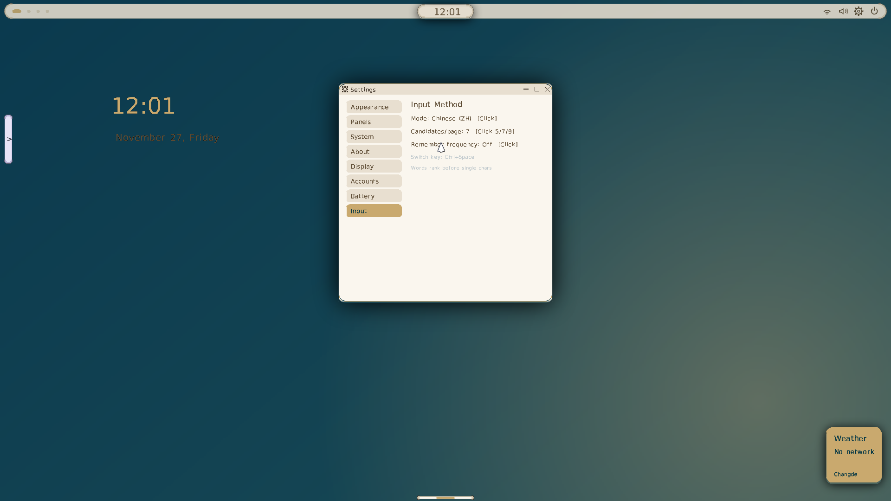
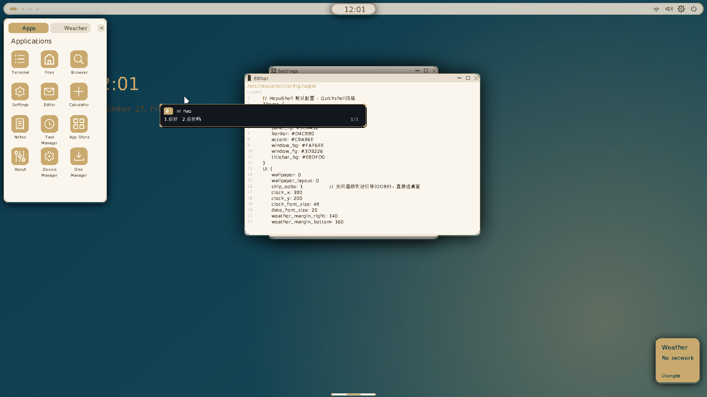
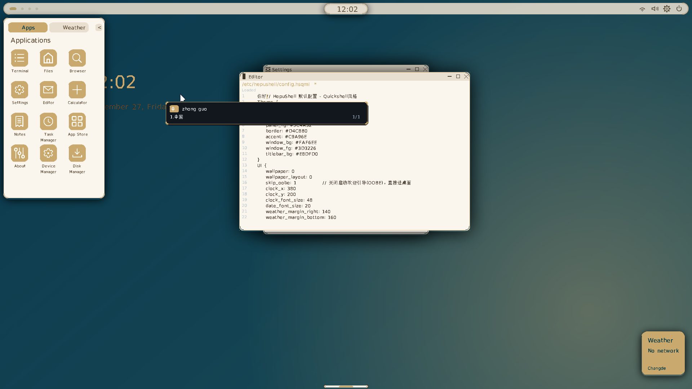
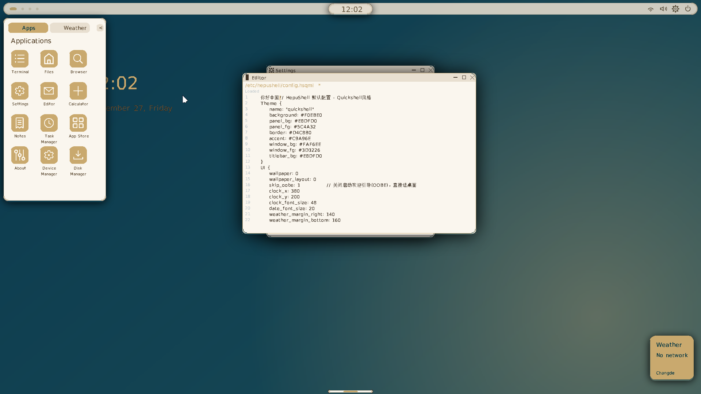
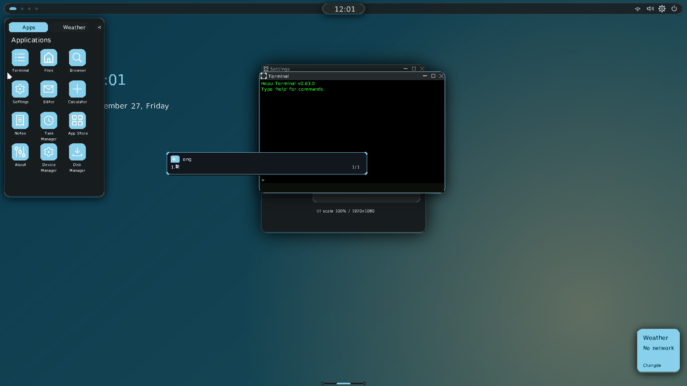
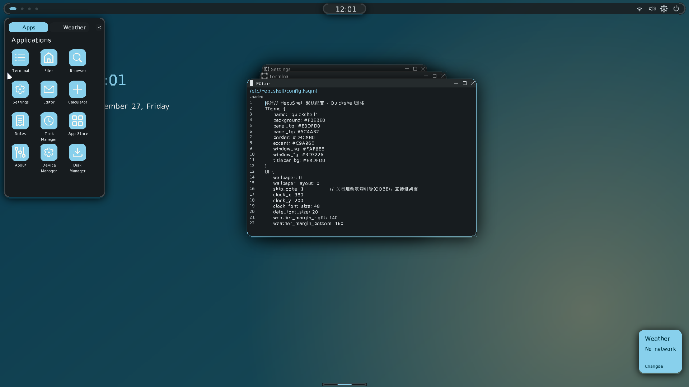
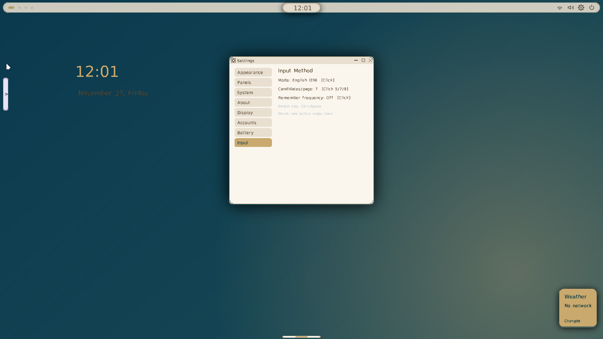
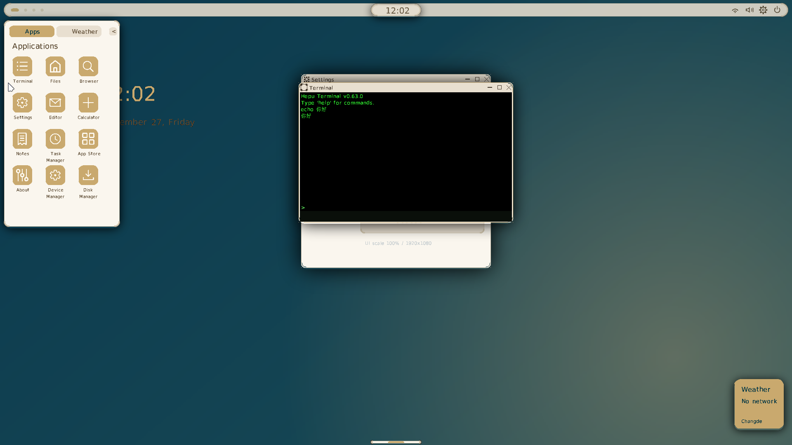
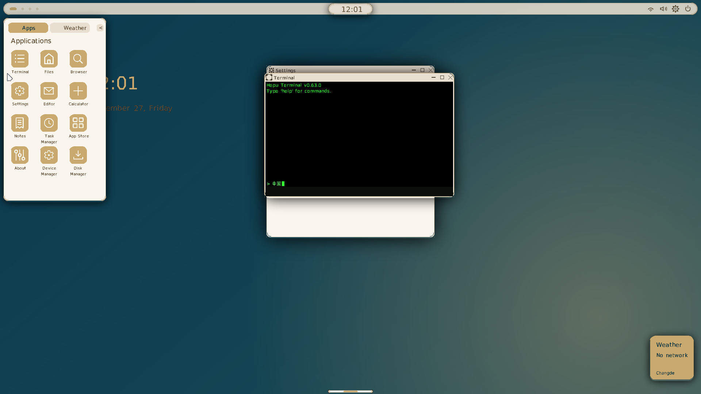
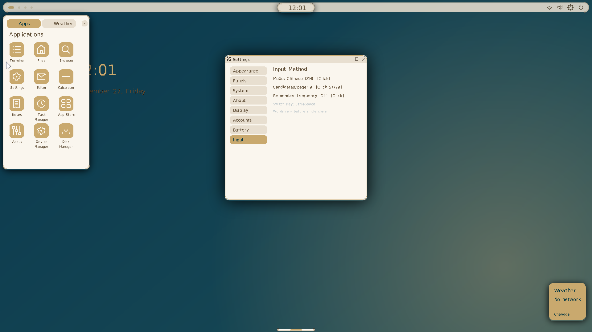

# 赫普 OS 输入法 M3 交付记录（2026-11-28）

状态：M3 已完成；代码、词表、测试脚本与本文档在本轮提交中一并入库。QEMU 结论均为合成环境，不是真机验证。

## 1. 交付范围

- 词库扩到 GB2312 一级 3,755 字级别，生成表为 407 个拼音组、3,769 个去重汉字、5,227 个“字-读音”出现、28,156B；最大组 `yi` 82 字。
- 候选缓存上限 `IME_CAND_MAX=99`，默认每页 9 个；`yi` 组 11 页，5/页时 20 页。
- 候选条显示拼音分段：`nihao → ni hao`、`zhongguo → zhong guo`；组合中左键 `0x92` 上一页、右键 `0x93` 下一页。
- Settings 64 位导航新增 Input 页，三行真实开关：Mode / Candidates/page / Remember frequency；分别写 `sys.ime_mode`、`sys.ime_candidates`、`sys.ime_freq`。
- 保留词组优先、词频排序与简拼；`nh → 你好` 在主机测试中继续成立。

## 2. 关键实现文件

| 文件 | 作用 |
|---|---|
| `kernel/shared/ime/ime_data_table.c` | 生成后的拼音单字表（407 组 / 3,769 字） |
| `tools/ime-data/gb2312-level1-pinyin.txt` | GB2312 一级 3,755 字读音数据 |
| `tools/ime-data/LICENSE-pinyin-data.txt` | `mozillazg/pinyin-data` v0.16.0 MIT 许可 |
| `tools/gen_ime_data.py` | 词表生成器；重复生成结果稳定 |
| `kernel/shared/ime/ime.c` | 分段、上一页、页大小、词频开关；关闭词频后不记录/不落盘 |
| `kernel/arch/x86_64/hs_ime.c/.h` | 候选条分段、组合中左右翻页、Settings 包装与初始化读取 |
| `kernel/arch/x86_64/hpdesk.c` | Settings Input 页、8 项导航与点击处理 |
| `tools/regress/ime_m3_editor_probe.sh` | 编辑器分段/翻页/上屏取证 |
| `tools/regress/ime_settings_probe.sh` | Settings 三项点击取证 |
| `tools/regress/ime_settings_persist_probe.sh` | 候选数/词频跨重启取证 |
| `tools/regress/ime_persist_probe.sh` | 模式/词频跨重启取证（已适配扩表后的 `eng` 选 1） |

## 3. 验证结果

| 项 | 结果 |
|---|---|
| 构建 | `kernel64.bin=1,263,312B`、`kernel32.bin=3,899,021B`、`kernel32.elf=4,083,832B`、`image=268,435,456B` |
| 主机测试 | 22/22 PASS（`/tmp/m3-host7.log`） |
| 字库 | 3,769/3,769 覆盖，`font_cjk_big` 3,789 码点 |
| 常用样本首屏 | 500 字 472/500=94.4%；100 词组 100/100；详见 `FIRSTPAGE.md` |
| 100% 九态视觉 | 9/9 PASS；02 mean=0.085，03–09 mean=0.042，01 mean=0.000（`/tmp/m3-visual-final2-compare.log`） |
| 32 位 smoke | 最终复跑 `ext2_mounted=1`、整体 PASS（`/tmp/m3-smoke32-final3.log`） |
| 终端 | `echo ` + `nihao` + `1` + 回车输出 `你好`（`/tmp/hepu-ime-term-m3b/05-echo-output.png`） |
| 编辑器 | `nihao → ni hao → 你好`；`yi` 1/11↔2/11；`zhongguo → zhong guo → 你好中国`（`/tmp/hepu-ime-m3e3/`） |
| Settings 点击 | Mode → Chinese (ZH)，Candidates/page → 7，Remember frequency → Off（`/tmp/hepu-ime-settings-final3/`） |
| Settings 跨重启 | 磁盘 `sys.ime_candidates=7`、`sys.ime_freq=off`；第二次启动 Input 页显示 7/Off（`/tmp/hepu-ime-settings-persist/`） |
| 词频关闭端到端 | Off 后输入 `zhongguo` 选 1（中国），`freq.txt` 与基线逐字节一致，仍为 `鞥 1`；第三次启动仍 Off（`/tmp/hepu-ime-freq-off/`） |
| 模式/词频跨重启 | 磁盘 `sys.ime_mode=zh`、`freq.txt` 为 `你好 1`/`鞥 1`；第二次启动 `eng` 直接弹 ZH 候选（`/tmp/hepu-ime-persist-m3c/`） |

## 4. 证据截图

### Settings Input

### 编辑器分段、翻页与上屏

### 跨重启与终端

### Remember frequency Off 端到端

## 5. 边界

- 常用 500 字首屏 472/500（94.4%），未进首屏的 28 字全部仍在词表/字库中；原因是 `di`、`dian`、`gu` 等读音组候选超过 9 个，首屏只放前 9 个。100 词组首屏 100/100。明细见 `FIRSTPAGE.md`。
- 若要把 500 字首屏命中率继续拉高，应做“常用字优先”排序，不应再扩字表。
- 启动时间没有独立量化，只记录内核/镜像体积；不能声称“启动时间已验证”。
- 真实 P3 `/data` 分区、只读盘/无 `/data` 降级、候选条在窗口右侧/底部边界的鼠标命中仍未验证。
- M3 持久化首轮曾落到 OOBE 首启页，未计入证据；清理夹具后复跑通过。32 位 smoke 早期一次出现 `ext2_mounted=0`，同一构建复跑 `ext2_mounted=1`/PASS；这是启动夹具 flakiness，不写成稳定通过。
- 32 位 Settings 仍为 7 项导航，没有 Input 页；32 位桌面仍使用独立 `kernel/drivers/ime.c`，共享 IME 只服务 64 位桌面。
